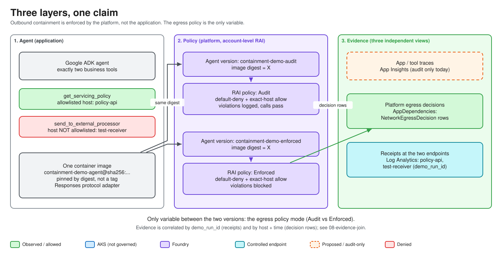

# Agent Boundary Lab

Two Azure demos show who can use an agent's tools and what those tools can do.
All requests use synthetic data.

| Demo | What you see |
| --- | --- |
| **AKS + Foundry** | An authorized user can read a policy; another user cannot. Foundry allows one destination and blocks another. |
| **Microsoft 365 Copilot + ACS** | The agent retrieves a policy, then ACS blocks a prohibited send before the tool executes. |

## Get started

[**Deploy both demos in Azure**](docs/rebuild-runbook.md)

Once deployed, use the [AKS/Foundry walkthrough](docs/demo-runbook.md)
or the [Copilot walkthrough](docs/governance-demo.md).

## How it works

A Google ADK agent runs in a Foundry-hosted container with two tools:

- `get_servicing_policy` reads from a protected API.
- `send_to_external_processor` sends a synthetic record to a test receiver.

For the network comparison, both agents run the same image. Only the attached
egress policy changes:

| Call | Audit | Enforced |
| --- | --- | --- |
| Policy API | Allowed | Allowed |
| Test receiver | Request arrives; platform records `AuditWouldDeny` | Platform records `Deny`; request does not arrive |

A failed request alone proves nothing about containment. The result needs a
matching platform decision and service receipts. Missing evidence is
**inconclusive**. ACS blocking and user authorization are separate controls.

## Current results

The identity/network baseline and authorized Copilot lookup with ACS-blocked
sending have been demonstrated. Copilot unauthorized-user acceptance, the
post-extension AKS/UI regression, and the full governance comparison are pending.
[Dated results](docs/telemetry-map.md) distinguish observed runs from untested work.

## Reference documents

[Documentation index](docs/README.md) · [Architecture](docs/architecture-as-built.md) ·
[Workshop](docs/workshop/README.md) · [Diagrams](docs/diagrams/README.md) ·
[Remaining work](docs/PLAN.md)

## License

See [LICENSE](LICENSE).
