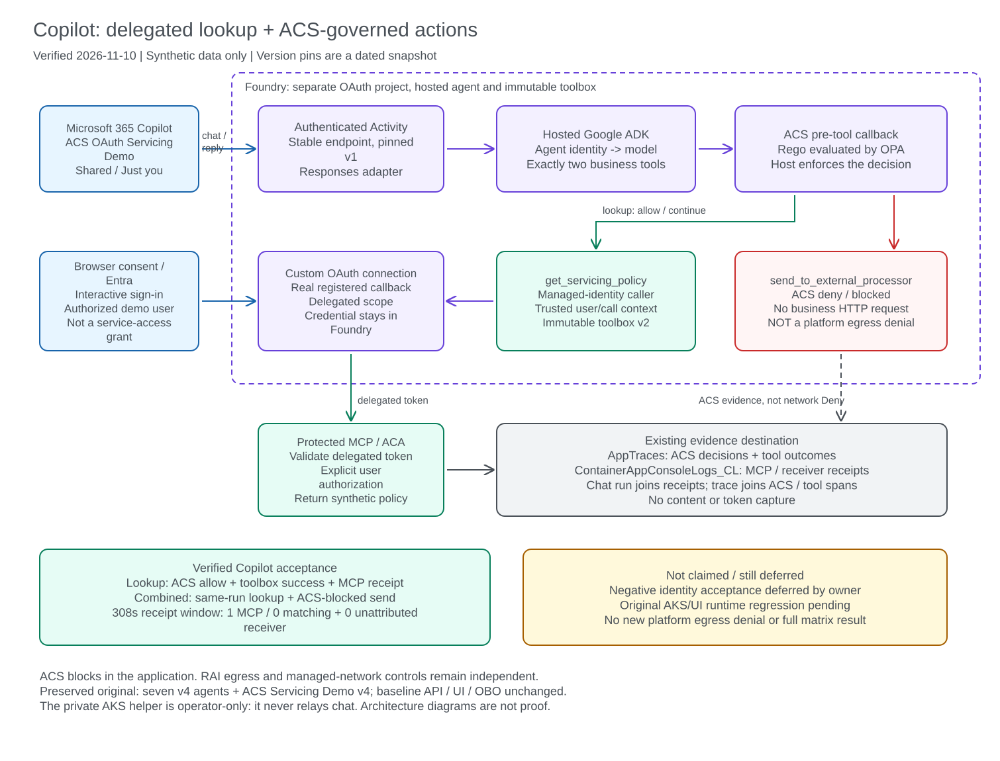

# Architecture

The business tools run in **Foundry**, not AKS. AKS hosts the browser client and
deployment helpers. Microsoft 365 Copilot reaches Foundry directly.



[Editable diagram](diagrams/copilot-oauth-flow.excalidraw)

## Execution and boundaries

```text
Browser -> AKS harness -> A2A bridge -> Foundry Responses
  -> Google ADK agent
       -> get_servicing_policy       -> protected policy API
       -> send_to_external_processor -> test receiver
```

The Audit and Enforced agents use one image digest and identical tool
configuration. Their RAI network policy is the experimental variable.
Both destinations are allowed by the separate managed-network layer.

Both tools are always registered. They accept no model-supplied URLs and use
verified TLS, bounded timeouts, and no redirects. The diagnostic route reuses
the same implementations.

The AKS bridge implements A2A over Foundry Responses. Native inbound A2A to a
hosted agent returned `HOSTED_AGENT_NOT_SUPPORTED`.

## Microsoft 365 Copilot runtime path

```text
Microsoft 365 Copilot -> Foundry Activity endpoint -> hosted adapter -> ADK
  -> Model proposes a tool
  -> ACS evaluates it through Rego/OPA
       allow lookup -> Foundry toolbox -> OAuth connection -> protected MCP
       block send   -> governance_denied; tool does not execute
  -> Reply to Copilot, with Demo run: chat-<uuid>
```

**No AKS ingress, bridge, or UI relays this conversation.** The private AKS
helper manages deployments and publications only.

| Copilot entry | Lookup transport | Purpose |
| --- | --- | --- |
| **ACS OAuth Servicing Demo** | Toolbox with delegated OAuth | Policy lookup and blocked sending |
| **ACS Servicing Demo** | Direct HTTP, without the channel's delegated connection | Earlier blocked-send demo |

The OAuth entry has its own project, agent image, protected MCP service, policy,
connection, toolbox version, and publication. It shares the account's managed
network, model capacity, and existing telemetry destination.

## Identity

The browser harness exchanges the signed-in user's token for a policy API token
on their behalf. The bridge forwards it into request-scoped hosted-agent state.
The policy API validates it and checks the user's authorization.

In Copilot, the managed-identity toolbox caller supplies trusted user/request
context; the OAuth connection handles the downstream delegated token.
Consent does not add a user to the service's allowed list.

The hosted agent uses its own Entra credential for model access.
The external-processing tool never receives the user's policy token.
[Identity flow](token-flow-documented.md)

## Components

| Component | Runs in | Source |
| --- | --- | --- |
| ADK agent, tools, Responses adapter | Foundry container | [src/containment_demo](../src/containment_demo/) |
| ACS evaluator and Rego policies | Same container | [governance](../src/containment_demo/governance/), [policies/acs](../policies/acs/) |
| Browser harness, A2A bridges, optional CPU model, test UI | AKS | [deploy/kustomize](../deploy/kustomize/) |
| Policy API and test receiver | Container Apps | [src/services](../src/services/) |
| Baseline resources | Azure | [infra/cloud](../infra/cloud/) |
| Governance policies | Azure, separate Terraform state | [infra/governance](../infra/governance/) |
| OAuth project and MCP service | Azure, separate Terraform state | [infra/copilot-toolbox](../infra/copilot-toolbox/) |
| Decisions, traces, receipts | Application Insights / Log Analytics | [Telemetry map](telemetry-map.md) |

## Independent controls

| Control | Enforces | Does not establish |
| --- | --- | --- |
| Entra and API authorization | User/service access | Network containment |
| ACS | Whether a proposed tool executes | Platform egress denial |
| RAI egress policy | Hosted sandbox outbound HTTP/HTTPS destinations | Protection of AKS callers |
| Private endpoint and inbound ACLs | Who can reach Foundry | Outbound containment |
| Managed network | Runtime connectivity | Which RAI rule caused a failure |

Terraform defaults Foundry public access to Disabled. The recorded Copilot
deployment uses Enabled with selected-IP/default-Deny ACLs and authenticated
Activity access. These inbound settings are separate from outbound policy.

ACS-denial scenarios allow both API hosts at the network layer. Network-denial
scenarios allow tool execution and deny the receiver at the RAI layer.
That separation makes the source of each block identifiable.

## Evidence

Each result needs the run's actual decision and receipt records.
Application `OperationId` did not join to platform egress records; the lab uses
the run marker embedded in the request path.

ACS-blocked tools make no outbound request, so no platform Deny is expected for
them. Receiver absence needs a successful servicing receipt and a mature ingestion
window. A model reply or HTTP error alone is insufficient.

[Recorded results](telemetry-map.md) · [Queries](kql-queries.md) ·
[Deploy](rebuild-runbook.md) · [Deferred work](PLAN.md#deferred-features)
