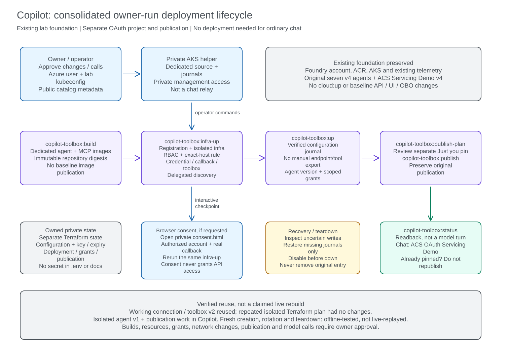

# Diagrams

The diagrams show how the pieces connect. They are not evidence; see the
[telemetry map](../telemetry-map.md) for results.

| Diagram | Shows |
| --- | --- |
| [`copilot-oauth-flow`](copilot-oauth-flow.excalidraw) ([SVG](copilot-oauth-flow.svg)) | Copilot → hosted agent → ACS → toolbox/OAuth → protected MCP, plus the evidence trail |
| [`copilot-deployment-flow`](copilot-deployment-flow.excalidraw) ([SVG](copilot-deployment-flow.svg)) | Build, infrastructure and consent, deploy, publish, status |
| [`environment`](environment.excalidraw) ([SVG](environment.svg)) | AKS and Foundry baseline: laptop, AKS, Foundry, Container Apps, ACR, evidence. No ACS or Copilot. |
| [`azure-environment`](azure-environment.excalidraw) ([SVG](azure-environment.svg)) | Earlier Azure-resource-only view. Superseded. |

**Colors in the Copilot diagrams:** green is the permitted lookup, purple is Foundry, blue is user identity or operator access, gray is evidence or unchanged components, amber is a deferred check. Red is an ACS block, not a network denial. Dashed lines carry evidence.

The AKS helper only deploys and manages resources. It never relays chat.

**Colors in `environment`:** green is observed, blue is the AKS caller (not governed by the Foundry policy), purple is Foundry, teal is a controlled endpoint, orange dashed is proposed, red is blocked.

## Edit and export

1. Open the `.excalidraw` file with the VS Code *Excalidraw* extension or locally at [excalidraw.com](https://excalidraw.com). Don't upload private configuration.
2. Edit, then export an SVG with the same base name into this folder.
3. Commit the source and SVG together. Never edit the SVG by hand.
