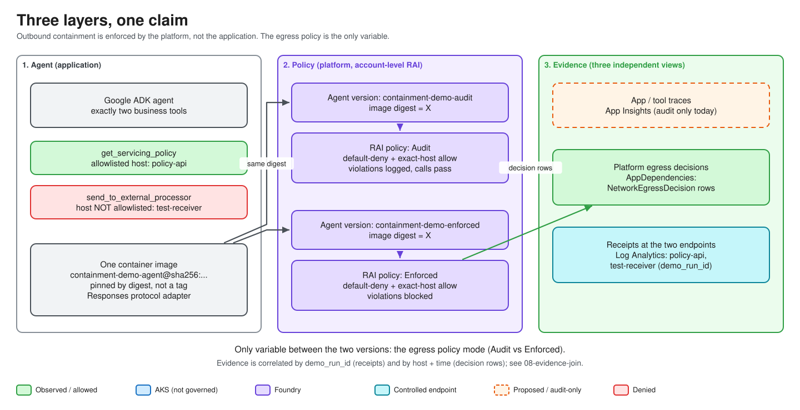

# 01: Architecture

**What stops an agent's tool from calling a prohibited destination?**
This lab tests a platform control, not a prompt instruction or a check in tool code.

## The experiment

| Layer | What it does |
| --- | --- |
| Agent | Google ADK runs two tools inside a Foundry-hosted container |
| Policy | Audit and Enforced RAI policies differ in network enforcement mode |
| Evidence | Tool results, platform decisions, and API receipts identify what happened |

Both agents run the same image digest and register both tools.

| Tool | Audit | Enforced |
| --- | --- | --- |
| `get_servicing_policy` | Allowed | Allowed |
| `send_to_external_processor` | Reaches receiver; would-deny recorded | Blocked by platform |

Audit establishes that the request works without enforcement. Enforced must then
show a matching platform Deny and no receiver receipt.

## The boundaries

The browser harness and bridge run on AKS. Their traffic is not governed by
Foundry's egress policy. A private endpoint controls inbound access, not where
tools can send requests.

User authorization is another independent check: the policy API validates the
user's delegated token. ACS is separate again: it can block a proposed tool
before execution. [Architecture](../architecture-as-built.md)

## Check your understanding

A tool returns 403 but there is no platform decision. Is that containment?
**No: it is inconclusive.** The destination itself could have rejected the request.

**Next:** [02: Prerequisites](02-prerequisites.md)
