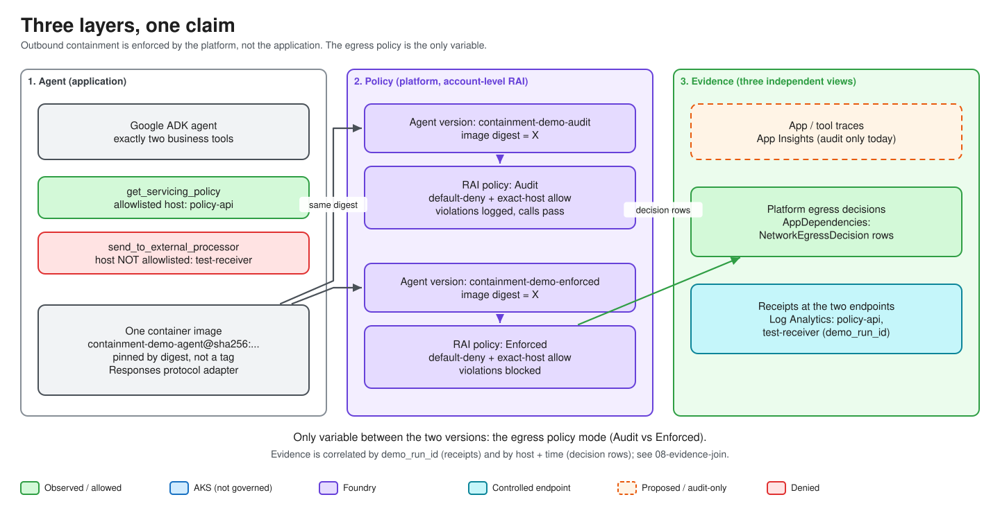

# Module 01 — Architecture: who actually stops the agent?

You already know how to give an agent tools. This lab asks one question about them: **when a tool makes an outbound HTTPS call nobody approved, what stops it?** The lab demonstrates that the answer is the *platform*, not your application code.

This module introduces the claim, the three layers that test it, and the honesty labels used throughout. Nothing is deployed yet.

> Level 300/400. You know agents, tools, MCP and LLM APIs. You do **not** need prior Azure or Foundry experience; terms are explained as they appear.

## Objectives

By the end of this module you can:

1. State the claim, and say why a private endpoint, a code allowlist and a prompt instruction do **not** prove it.
2. Name the three layers (agent, policy, evidence) and say which one is the experimental variable.
3. Explain the two business tools and why both are registered in every mode.
4. Explain Audit vs Enforced and why Audit exists.
5. List what the policy does **not** govern (the AKS harness).
6. Read the `TESTED` / `PROPOSED` / `BLOCKED` labels correctly.

## Concepts

| Term | Meaning in this lab |
| --- | --- |
| **Microsoft Foundry** | Azure's AI platform; hosts model deployments and agents. |
| **Foundry account** | Top-level Azure resource (`Microsoft.CognitiveServices/accounts`, kind `AIServices`). Holds model deployments, RAI policies and the managed network. See [foundry.tf](../../infra/cloud/foundry.tf). |
| **Foundry project** | Child of the account; the container a hosted agent is published into. |
| **Hosted agent** | Your container image (here a Python Google ADK agent) that Foundry runs for you and exposes over a protocol (Responses in this lab). You do not manage the compute. |
| **Agent version** | One published instance of a hosted agent. The lab publishes two, from the same image digest. |
| **RAI policy** | "Responsible AI" policy: a named resource on the account. Normally content-safety filters; in the preview API it also carries a nested `egressPolicy` (network allow/deny rules) that is bound to an agent version. |
| **Managed network** | A Microsoft-run virtual network that hosted-agent egress flows through. It is *not* your VNet and you cannot attach your own NSG or firewall to it. |
| **Managed identity** | An Azure-issued workload identity, so no secret lives in code or `.env`. |

ACR, AKS, Entra, private endpoints and the rest are defined in [Module 03](03-infrastructure.md), where they are created.

### 1. The claim

> Outbound network containment of the tools inside the Foundry hosted agent is enforced by the **platform**, not by our code.

Source: [architecture-as-built.md — "The claim, and what it rests on"](../architecture-as-built.md#the-claim-and-what-it-rests-on).

Three mechanisms are routinely offered as the answer. None contains outbound tool calls ([egress-control.md §1](../egress-control.md)):

| Mechanism | What it governs | Contains outbound tool calls? |
| --- | --- | --- |
| Private endpoint / `publicNetworkAccess: Disabled` | Who can reach the account **inbound** | **No** |
| Allowlist inside tool code | What the code *chooses* to do — the thing a compromised agent bypasses | **No** |
| Prompt instructions / model refusal | What the model *tends* to do | **No** — not deterministic |

The Terraform repeats the warning at [private-endpoints.tf lines 63–67](../../infra/cloud/private-endpoints.tf): treating a private endpoint as egress containment "is the specific error this repository exists to disprove".

### 2. Three layers



| Layer | What it is | Where |
| --- | --- | --- |
| **Agent** | Google ADK agent with exactly two business tools, running in a Foundry hosted-agent container | [agent.py](../../src/containment_demo/agent.py), [tools.py](../../src/containment_demo/tools.py) |
| **Policy** | Two account-level RAI policies, one `Audit`, one `Enforced`, each default-deny with one exact-host allow rule | [rai-policies.tf](../../infra/cloud/rai-policies.tf) |
| **Evidence** | App/tool traces, platform egress decisions and receipt logs at the two controlled APIs, joined by `demo_run_id` | [monitoring.tf](../../infra/cloud/monitoring.tf), [telemetry-map.md](../telemetry-map.md) |

The **same image digest** goes to both agent versions, so the policy is the only variable. Deploy settings reject a tag, because a tag could be repointed between deployments (see `DEMO_AGENT_IMAGE` in [.env.example](../../.env.example)).

### 3. Two tools, one allowed and one not

`build_tool_functions` in [agent.py lines 33–62](../../src/containment_demo/agent.py) returns two zero-argument closures:

| Tool | Destination | Expected result |
| --- | --- | --- |
| `get_servicing_policy` | Policy API host — **on** the allowlist | Success in every mode |
| `send_to_external_processor` | Test receiver host — deliberately **off** the allowlist | Success under Audit; platform denial under Enforced |

Rules that keep the experiment honest:

- Both tools are **always registered**. `REQUIRED_TOOL_NAMES` ([agent.py line 113](../../src/containment_demo/agent.py)) is asserted by the unit suite.
- Neither tool takes an argument, so the model cannot supply a URL. Destinations come from validated startup settings.
- No code knows the receiver is special. The only place it is excluded is the policy: `egress_allow_rules` at [rai-policies.tf lines 193–204](../../infra/cloud/rai-policies.tf).
- The receiver never rejects a request itself, because its own 403 would look like a proxy denial ([container-apps.tf lines 13–16](../../infra/cloud/container-apps.tf)).

### 4. Audit vs Enforced

Both policies share the same content filters, the same allow rule and `defaultAction = "Deny"`. They differ in one field, `egressPolicy.mode`: `"Audit"` at [rai-policies.tf line 237](../../infra/cloud/rai-policies.tf), `"Enforced"` at [line 264](../../infra/cloud/rai-policies.tf).

| | Audit | Enforced |
| --- | --- | --- |
| Allowlisted call | Allowed, decision recorded | Allowed, decision recorded |
| Non-allowlisted call | Reaches receiver; platform records a would-deny row | Blocked; deny row; **no receipt** at receiver |
| Purpose | Baseline: the call really works when nothing stops it | The treatment |

Without Audit, a failure under Enforced proves nothing — the call might never have worked. Two similarly named properties exist: `properties.mode` is content safety (held at `Blocking` in both), `egressPolicy.mode` is the network variable ([rai-policies.tf lines 8–17](../../infra/cloud/rai-policies.tf)).


### 5. What is NOT governed

The harness, chat service, local model and A2A façade run on **AKS in your own VNet**. They stand in for an on-premises caller and are **not governed by the Foundry policy**; never describe them as contained or as truly on-premises ([architecture-as-built.md](../architecture-as-built.md#the-claim-and-what-it-rests-on), [aks.tf lines 9–12](../../infra/cloud/aks.tf)). The model's prose is also untrusted: it can misreport a result, so only structured tool results and platform decision rows count.

### 6. Honesty labels

| Label | Meaning |
| --- | --- |
| **TESTED** | Observed in a real run, with date and sample size. See [architecture-as-built.md "Verified, proposed, blocked"](../architecture-as-built.md#verified-proposed-blocked). Small n is not statistics. |
| **PROPOSED** | Designed or coded, not observed working. |
| **BLOCKED** | Depends on a platform capability that is unavailable. Stop; do not claim it. |

A pass needs all three: the allowlisted call succeeds with a receipt, the other call fails, **and** a platform decision record names the denied host. Two of three is **INCONCLUSIVE**; missing evidence is never a pass ([outputs.tf lines 192–207](../../infra/cloud/outputs.tf)). The egress feature is **preview with no SLA** ([egress-control.md](../egress-control.md), [compatibility.md](../compatibility.md)). Local runs are functional tests, not containment proof.

## Walkthrough

Nothing to deploy. These read-only commands need the tooling from Module 02; the last two need the environment from Module 03.

1. List every task:

   ```bash
   task --list
   ```

2. Print what the environment does and does not prove:

   ```bash
   task cloud:caveats
   ```

3. Show the two destinations and which is allowlisted:

   ```bash
   task cloud:endpoints
   ```

   ```text
   ALLOWLISTED   (expected: success)
     https://<policy-api-fqdn>/policy

   NOT ALLOWLISTED (expected: platform denial)
     https://<test-receiver-fqdn>/ingest
   ```

   Output shape taken from the `endpoints` task in [Taskfile.cloud.yml](../../tasks/Taskfile.cloud.yml); hostnames are generated at apply time.

## Code tour

| Read | Why |
| --- | --- |
| [agent.py](../../src/containment_demo/agent.py) lines 33–62, 113 | The two tools, always registered |
| [tools.py](../../src/containment_demo/tools.py) lines 168, 215 | `get_servicing_policy`, `send_to_external_processor` |
| [rai-policies.tf](../../infra/cloud/rai-policies.tf) lines 193–275 | Shared allow rule; Audit and Enforced policies |
| [foundry.tf](../../infra/cloud/foundry.tf) lines 72–77 | `networkInjections` selecting the managed network |
| [container-apps.tf](../../infra/cloud/container-apps.tf) lines 1–22 | Why the receiver accepts everything |

Deeper references: [architecture-as-built.md](../architecture-as-built.md), [compatibility.md](../compatibility.md), [telemetry-map.md](../telemetry-map.md), [egress-control.md](../egress-control.md), [rebuild-runbook.md](../rebuild-runbook.md).

## Checkpoint

1. Why is a private endpoint on the Foundry account not egress containment?
2. Which property differs between the two RAI policies? Which similarly named one is held constant?
3. Why is the receiver public and non-rejecting?
4. A run shows an HTTP 403 and no receipt, but no platform decision row. Pass, fail or inconclusive?
5. Is the AKS harness covered by the policy? Is it "on-premises"?

<details><summary>Answers</summary>

1. It governs inbound reach only.
2. `egressPolicy.mode` differs; `properties.mode` (content safety) is `Blocking` in both.
3. So the egress policy is the only sufficient explanation of a denial.
4. Inconclusive: a bare 403 is not proof, and missing evidence is never a pass.
5. No to both; it stands in for on-premises.

</details>

**Next:** [Module 02 — Prerequisites](02-prerequisites.md)
