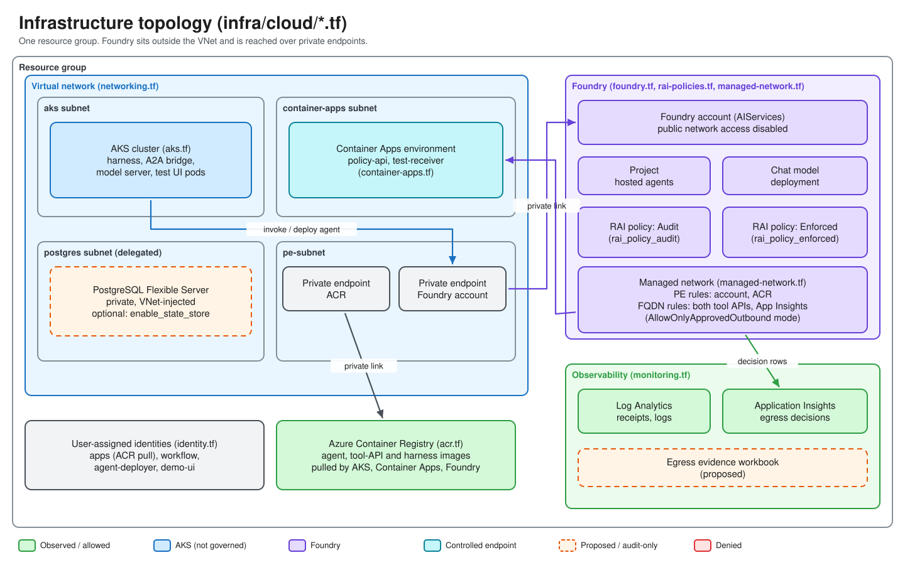

# 03: Infrastructure

Deploy using [Part 1 of the Azure guide](../rebuild-runbook.md#part-1-aks-and-foundry-demo).
This page explains what those commands create.



## Two network environments

| Network | Purpose |
| --- | --- |
| Your Azure VNet | AKS, private endpoints, and the Container Apps environment |
| Foundry managed network | Hosted-agent connectivity and approved outbound destinations |

AKS subnet rules do not govern the Foundry sandbox. Both controlled API hosts
are allowed by the managed network; the RAI policy distinguishes them.

## Terraform layout

| Files under `infra/cloud/` | Resources |
| --- | --- |
| [foundry.tf](../../infra/cloud/foundry.tf), [model-deployments.tf](../../infra/cloud/model-deployments.tf) | Foundry account/project and pinned model deployment |
| [rai-policies.tf](../../infra/cloud/rai-policies.tf) | Audit/Enforced network policies |
| [managed-network.tf](../../infra/cloud/managed-network.tf) | Approved outbound hosts and Foundry's private ACR access |
| [aks.tf](../../infra/cloud/aks.tf), [acr.tf](../../infra/cloud/acr.tf) | Kubernetes cluster and image registry |
| [networking.tf](../../infra/cloud/networking.tf), [private-endpoints.tf](../../infra/cloud/private-endpoints.tf) | VNet, subnets, private IPs, and DNS |
| [container-apps.tf](../../infra/cloud/container-apps.tf) | Policy API and test receiver |
| [identity.tf](../../infra/cloud/identity.tf), [demo-ui-identity.tf](../../infra/cloud/demo-ui-identity.tf) | Workload identities and scoped grants |
| [monitoring.tf](../../infra/cloud/monitoring.tf), [project-connections.tf](../../infra/cloud/project-connections.tf) | Workspace, Application Insights, collection, and project connection |
| [postgres.tf](../../infra/cloud/postgres.tf) | Optional state store; disabled |

Names derive from a generated random name. Outputs feed the application tasks.
Bootstrap imports the managed network Azure creates with the account.
The first apply uses placeholder API images; application deployment replaces them.

## Inspect a deployed lab

```bash
task cloud:output
task cloud:endpoints
task cloud:policies
task cloud:app-insights-connection
```

Check actual policy attachments and monitoring routes before running the demo.
Configuration alone does not establish a network block.

**Next:** [04: Identity](04-identity.md)
