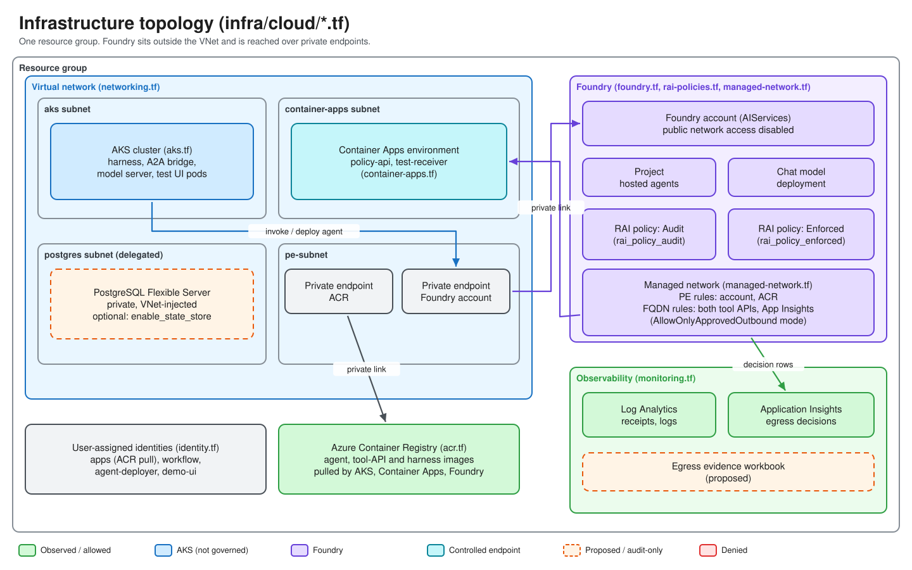

# Module 03 — Infrastructure: the Terraform walk-through

All Azure resources are declared in [infra/cloud/](../../infra/cloud/) and driven through `task cloud:*`. This module walks every file, explains the Azure terms as they appear, and shows the commands to plan and apply. **Applying creates billable resources (AKS, Foundry, Premium ACR, managed firewall); get owner approval first.**

## Objectives

1. Explain what each Terraform file creates and why.
2. Distinguish the **VNet you own** from the **Foundry managed network** — the core of the lab.
3. Explain the identity model: who may pull images, invoke agents, deploy agents.
4. Follow the naming convention built in `locals.tf` / `random.tf`.
5. Plan and apply the environment with the right bootstrap order, then verify it.

## Concepts

| Term | Meaning |
| --- | --- |
| **Resource group (RG)** | Container for the lab's resources. One RG here; AKS also gets a platform-managed node RG. |
| **VNet / subnet / NSG** | Your private IP network, its address slices, and a packet-filter attached to a subnet. |
| **Private endpoint (PE)** | A private IP in your VNet that maps to one PaaS resource (e.g. the Foundry account). Governs **inbound** reach only. |
| **Private DNS zone** | Makes the service's normal hostname resolve to the PE's private IP inside the VNet. |
| **Managed network (Foundry)** | Microsoft-run network that hosted-agent **egress** passes through, with an isolation mode and outbound rules. Not your VNet. |
| **ACR** | Azure Container Registry. Stores the container images. |
| **AKS** | Azure Kubernetes Service. Here it hosts the harness (client side) and, later, the Dapr workflow app. |
| **Container Apps** | Serverless container hosting; runs the two controlled HTTPS endpoints. |
| **Entra ID** | Identity provider. **Managed identity**: Entra identity for a resource. **Workload identity / federated credential**: lets a Kubernetes service account act as a managed identity without a secret. |
| **Log Analytics / Application Insights** | Log store and application telemetry service; where evidence lands. |
| **azapi vs azurerm** | `azurerm` is the mainstream Terraform provider; `azapi` calls ARM directly and is used for preview Foundry resources ([providers.tf](../../infra/cloud/providers.tf)). |

## Topology



Two networks, deliberately unconnected:

| Network | Hosts | Governs |
| --- | --- | --- |
| Your VNet ([networking.tf](../../infra/cloud/networking.tf)) | AKS nodes, private endpoints, Container Apps environment, optional PostgreSQL | Inbound reach, harness traffic |
| Foundry managed network ([managed-network.tf](../../infra/cloud/managed-network.tf)) | The hosted agent's outbound calls | Agent egress, together with the RAI egress policy |

No NSG or route table in this repository can affect what the agent reaches ([foundry.tf lines 1–10](../../infra/cloud/foundry.tf)).

## Walkthrough

Run from the repo root. Steps follow [rebuild-runbook.md §1](../rebuild-runbook.md#1-infrastructure).

1. :one: Confirm the target (read-only):

   ```bash
   task cloud:whoami
   task cloud:target-check
   ```

2. :two: Validate and plan (creates nothing):

   ```bash
   task lint:terraform
   task cloud:plan
   ```

3. :three: **Billable, first environment only.** Create the Foundry account and import its platform-created managed network into state (Azure creates `managednetworks/default` with the account; AzAPI refuses to create it again):

   ```bash
   task cloud:bootstrap
   ```

4. :four: **Billable.** Apply everything. Leave `ENDPOINT_IMAGE_TAG` unset: the endpoints run a placeholder image until the image builds push real ones.

   ```bash
   task cloud:up
   ```

   `cloud:up` runs `target-check`, `init`, the endpoint-image and managed-network guards, `terraform apply`, then `cloud:endpoints` ([Taskfile.cloud.yml lines 114–127](../../tasks/Taskfile.cloud.yml)). Allow up to tens of minutes. Status: the owner reported `cloud:up` succeeded on 2026-10-15; a full clean rebuild is **not yet re-verified** ([rebuild-runbook.md](../rebuild-runbook.md)).

5. :five: Re-plan; it must report no changes:

   ```bash
   task cloud:plan
   ```

   ```text
   No changes. Your infrastructure matches the configuration.
   ```

   The repo has no timestamp tag precisely so this check can pass ([locals.tf lines 43–62](../../infra/cloud/locals.tf)).

6. :six: Inspect outputs, endpoints and cluster access:

   ```bash
   task cloud:output
   task cloud:endpoints
   task cloud:kubeconfig
   task cloud:app-insights-connection
   ```

   `app-insights-connection` must be checked before trusting any run: without the project connection the platform layer is silent ([project-connections.tf](../../infra/cloud/project-connections.tf)).

7. Optional: `task cloud:base-policies` and `task cloud:policies` (proves the two RAI policies differ in exactly one field). Tear down with `task cloud:down` (deletes everything and removes local state; state is the local file `infra/cloud/terraform.tfstate`).

## Code tour: file by file

### Naming convention — [locals.tf](../../infra/cloud/locals.tf) and [random.tf](../../infra/cloud/random.tf)

Nothing is hand-named. [random.tf](../../infra/cloud/random.tf) creates a `random_pet` and a 2-byte `random_id`; [locals.tf line 10](../../infra/cloud/locals.tf) builds `resource_name = "<pet>-<decimal id>"` and every name derives from it (`-rg`, `-vnet`, `-foundry`, `-project`, `-logs`, `-ai`, `-aks`, `-cae`, `-pg`; lines 12–21).

| Rule | Where |
| --- | --- |
| ACR names forbid hyphens: hyphens stripped, `acr` appended, cut to 50 | [locals.tf line 24](../../infra/cloud/locals.tf) |
| Container App names cap at 32: prefix trimmed to ≤18 chars so `-test-receiver` always fits | [locals.tf lines 26–31](../../infra/cloud/locals.tf) |
| VNet is a random `/16` inside `10.0.0.0/8`, carved into `/24`s (AKS=1, PE=2, Container Apps=3, Postgres=4) | [locals.tf lines 36–41](../../infra/cloud/locals.tf); `random_integer.vnet_cidr` ([random.tf lines 19–23](../../infra/cloud/random.tf)) |
| AKS service/pod CIDRs drawn from ranges the VNet can never use | `services_cidr` 64–99, `pod_cidr` 100–127 ([random.tf lines 26–34](../../infra/cloud/random.tf)) |
| Generated secrets: diagnostics token (48 chars) and optional Postgres admin password | [random.tf lines 41–53](../../infra/cloud/random.tf) |
| Tags: `Application`, `AppName` only | [locals.tf lines 64–67](../../infra/cloud/locals.tf) |

The resource group is [locals.tf lines 70–75](../../infra/cloud/locals.tf). The provider pins (`azurerm ~> 4`, `azapi ~> 2`, `random ~> 3`, `time ~> 0.11`) are in [providers.tf](../../infra/cloud/providers.tf); [variables.tf](../../infra/cloud/variables.tf) holds every input (region `swedencentral`, model `gpt-5.4-mini`, AKS `Standard_D4as_v7` x2, `enable_state_store` default `false`).

### Foundry — [foundry.tf](../../infra/cloud/foundry.tf)

| Resource | Lines | Notes |
| --- | --- | --- |
| `azapi_resource.foundry` | 34–91 | Account: kind `AIServices`, SKU `S0`, system-assigned identity. `disableLocalAuth = true` (Entra only, no keys). `publicNetworkAccess` from `var.foundry_public_network_access` (default `Disabled`) with `networkAcls` default `Deny`. `networkInjections` with `useMicrosoftManagedNetwork = true` selects the managed network for scenario `agent`. |
| `azapi_resource.project` | 94–110 | The project. Waits for the model deployment and takes the account lock. |

Preview API `2025-10-01-preview`; `schema_validation_enabled = false` because the schema is not in provider metadata. `foundry_operation_retry` (lines 27–33) retries "another operation is in progress" because child writes contend on the account. Hosted agent **versions are intentionally not in Terraform**: the version API is preview, and publishing must pin a digest Terraform cannot know ([lines 112–125](../../infra/cloud/foundry.tf)). They are published by `task deploy:foundry-agent`. (The comment there names `task cloud:deploy-agent`, which does not exist in the Taskfiles.)

### Model — [model-deployments.tf](../../infra/cloud/model-deployments.tf)

One `azurerm_cognitive_deployment.chat`: `GlobalStandard`, pinned model version, `version_upgrade_option = "NoAutoUpgrade"` so the model cannot change between the Audit and Enforced runs.

### RAI policies — [rai-policies.tf](../../infra/cloud/rai-policies.tf)

| Item | Lines |
| --- | --- |
| `content_filters` copied verbatim from `Microsoft.DefaultV2` (a custom policy must supply its own) | 42–184 |
| `egress_allow_rules`: one `Fqdn` rule, `allow-policy-api`, host from `local.policy_api_host` | 193–204 |
| `rai_policy_audit` (`egressPolicy.mode = "Audit"`, `defaultAction = "Deny"`) | 207–243 |
| `rai_policy_enforced` (`"Enforced"`), created after Audit to serialise preview writes | 245–275 |

API `2026-05-15-preview`. Each requirement (`basePolicyName`, `contentFilters`) was found by a failed apply; see [compatibility.md](../compatibility.md). Matching is host/path only, no ports or IPs.

### Managed network — [managed-network.tf](../../infra/cloud/managed-network.tf)

| Resource | Lines | Purpose |
| --- | --- | --- |
| `azapi_resource.managed_network` | 110–129 | `managednetworks/default`, `isolationMode = var.managed_network_isolation_mode` (default `AllowOnlyApprovedOutbound`, **one-way**), `firewallSku = Standard` (billable) |
| `network_fqdn_rule` | 144–163 | FQDN rules for the policy API, the test receiver and `*.in.applicationinsights.azure.com`. Both controlled hosts are allowed at the **network** layer for *both* agents so the RAI egress policy stays the only variable |
| `foundry_self_pe_rule` + role | 21–47 | Outbound private-endpoint rule from the managed network back to the account (hosted agents otherwise got 403 "Public access is disabled"; observed, compatibility.md B9g) |
| `foundry_acr_pe_rule` + roles | 49–94 | Same for ACR (observed 2026-10-15 to restore hosted-agent provisioning); needs the *Azure AI Enterprise Network Connection Approver* and `Reader` roles |

The variable docs warn that managed-network traffic is **not logged yet** ([variables.tf lines 288–300](../../infra/cloud/variables.tf)): a network-layer block will not appear in evidence queries.

### ACR — [acr.tf](../../infra/cloud/acr.tf)

Premium registry, admin user off, public access on (images are pushed with `az acr build`; the registry is not under test). Role assignments, each a *different* principal doing a *different* pull:

| Role assignment | Principal | Purpose |
| --- | --- | --- |
| `aks_acr_pull` (24) | AKS kubelet identity | Nodes pull harness images |
| `apps_acr_pull` (31) | Container Apps identity | Endpoints pull their image |
| `foundry_acr_pull` (62), `foundry_project_acr_pull` (86) | Foundry account / project identity | Hosted-agent runtime pulls the agent image. The project grant is labelled "strongly indicated, unverified" in the file |
| `current_user_acr_push` (93) | You | Push via `az acr build` |

A missing pull right does not fail fast: the version sits in `creating` or ends `failed` with `ImageError` ([acr.tf lines 53–59, 70–83](../../infra/cloud/acr.tf)).

### AKS — [aks.tf](../../infra/cloud/aks.tf)

Standard-tier cluster (lines 27–107): Azure CNI **overlay** with **Cilium** data plane and network policy, system node pool autoscaling 1 to `2 * aks_node_count` on `AzureLinux`, local accounts disabled, Entra + Azure RBAC, `oidc_issuer_enabled` and `workload_identity_enabled` (needed for federated credentials), Azure Monitor agent to Log Analytics, KEDA. Version tracks the region default (lines 22–25, 41). Operators get *RBAC Cluster Admin* and *Cluster User Role* (lines 111–145). The cluster is the **client harness**, not under test.

### Networking — [networking.tf](../../infra/cloud/networking.tf)

VNet (16–23); `aks-subnet` with NSG (29–47); `containerapps-subnet` delegated to `Microsoft.App/environments` (56–70); `postgres-subnet` delegated to `Microsoft.DBforPostgreSQL/flexibleServers`, only when `enable_state_store` (80–96).

### Private endpoints — [private-endpoints.tf](../../infra/cloud/private-endpoints.tf)

`pe-subnet` (20), four private DNS zones (`privatelink.azurecr.io`, `…cognitiveservices.azure.com`, `…openai.azure.com`, `…services.ai.azure.com`; lines 27–53), a Foundry PE with all three AI zones (74–102) and an ACR PE (108–127). **Inbound only.** The controlled endpoints deliberately have no PE (lines 10–13), and there is no Key Vault (lines 15–17).

### Monitoring — [monitoring.tf](../../infra/cloud/monitoring.tf)

| Resource | Lines |
| --- | --- |
| Log Analytics workspace, `PerGB2018`, 30-day retention | 10–21 |
| Application Insights (workspace-based) | 23–31 |
| Diagnostic settings for account and project into the workspace | 45–73 |
| Data collection rule + association for AKS container logs/events | 77–117 |
| Evidence workbook (labelled **PROPOSED**, built from [kql-queries.md](../kql-queries.md)) | 119–138 |

Companion [project-connections.tf](../../infra/cloud/project-connections.tf) (line 61) adds the `AppInsights` project connection that is the only known route for platform egress decision records ([compatibility.md](../compatibility.md) C1/C4; schema details in the file header). Field names for the data are recorded in [telemetry-map.md](../telemetry-map.md).

### Container Apps — [container-apps.tf](../../infra/cloud/container-apps.tf)

Environment (51–69) on the delegated subnet, `Consumption` workload profile, public ingress by default (`test_endpoints_public = true`, a deliberate experimental choice). Two apps: `policy_api` (74) — the **allowlisted** destination — and `test_receiver` (129) — **not allowlisted**, accepts everything. Hostnames come from the live ingress FQDN (lines 26–27), so the allowlist cannot disagree with reality. The image is a placeholder until `var.endpoint_image_tag` is set (lines 29–48). Source of the apps: [services/policy_api/main.py](../../services/policy_api/main.py), [services/test_receiver/main.py](../../services/test_receiver/main.py).

### Identity — [identity.tf](../../infra/cloud/identity.tf) and [demo-ui-identity.tf](../../infra/cloud/demo-ui-identity.tf)

No secrets anywhere; each workload has its own identity so access reviews name one workload per right.

| Identity | Defined | Right | Scope |
| --- | --- | --- | --- |
| `apps` (user-assigned) | identity.tf 10 | ACR pull only | registry |
| `workflow` + federated credential | identity.tf 26, 34, 43 | Invoke the agent (Phases 8–9) | account |
| `agent_deployer` + federated credential | identity.tf 88, 96, 104 | Create agent versions from an in-VNet job (data plane is private). Which role is *required* is flagged NOT VERIFIED in the file | account |
| `demo_ui` + federated credential | demo-ui-identity.tf 11, 19, 27 | *Foundry Agent Consumer* (invoke only) | project |
| You (current user) | identity.tf 116, 122 | Foundry user and OpenAI user | account |

A federated credential binds an AKS service account (via the cluster OIDC issuer) to a user-assigned identity, so pods authenticate without secrets.

### PostgreSQL — [postgres.tf](../../infra/cloud/postgres.tf)

Optional and **off by default** (`enable_state_store = false`): a VNet-injected Flexible Server (`B_Standard_B1ms`, version 16, no public access, single zone) with a private DNS zone and one `workflow` database. It is the Dapr workflow state store for Phases 8–9, which nothing consumes yet. Check regional capability before enabling; advertised support does not prove provisioning ([lines 12–15](../../infra/cloud/postgres.tf)). Status: **PROPOSED**.

### Outputs — [outputs.tf](../../infra/cloud/outputs.tf)

Feed the `.env` values from Module 02: `policy_api_url`, `test_receiver_url`, `foundry_account_name`, `project_name`, `rai_policy_audit_id`, `rai_policy_enforced_id`, `acr_login_server`, and the sensitive `diagnostics_token`.

## Checkpoint

1. Which network governs the agent's outbound calls, and which Terraform file creates it?
2. Why do both controlled hosts appear in `network_fqdn_rule` yet only one in the RAI allow rule?
3. Why are there two different `AcrPull` grants for AKS and Foundry?
4. Why does `cloud:bootstrap` exist?
5. After `cloud:up`, what must `cloud:plan` print?
6. Is PostgreSQL deployed by default?

<details><summary>Answers</summary>

1. The Foundry managed network, from `networkInjections` in foundry.tf plus managed-network.tf, with the RAI egress policy.
2. The network layer treats both agents identically so the RAI policy remains the only variable.
3. Different principals perform unrelated pulls (kubelet vs hosted-agent runtime).
4. Azure creates `managednetworks/default` with the account and AzAPI needs it imported first.
5. No changes.
6. No; `enable_state_store` defaults to `false`.

</details>

**Previous:** [Module 02](02-prerequisites.md) · References: [architecture-as-built.md](../architecture-as-built.md), [compatibility.md](../compatibility.md), [telemetry-map.md](../telemetry-map.md), [egress-control.md](../egress-control.md), [rebuild-runbook.md](../rebuild-runbook.md)
