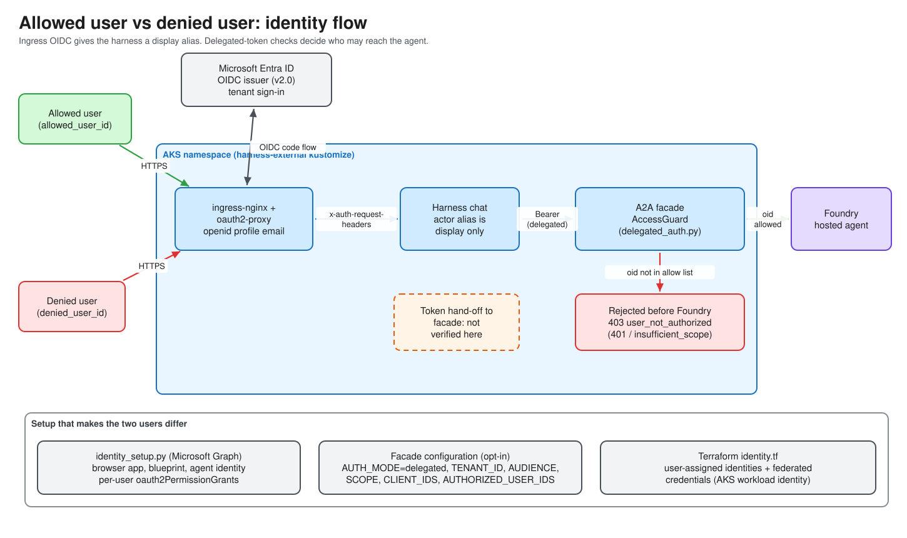

# Module 04 — Identity: Who Is Allowed to Ask the Agent?

Modules 01–03 proved *where the agent may send traffic*. This module covers the other half of the boundary: *who may talk to the agent at all*. You will see an **allowed** synthetic user and a **denied** synthetic user, an **oauth2-proxy** doing OIDC sign-in in front of the harness UI, and the **delegated-authorization** code that checks a user's own Entra token instead of a shared secret.

> **Status labels used in this module.** **TESTED** = covered by the repo's offline unit tests (`task identity:test`). **OWNER-REPORTED** = reported by the owner from live runs, not independently observed (see [identity-probe.md](../identity-probe.md)). **PROPOSED / BLOCKED** = designed but not proven. Identity denial is *not* network containment; never present one as the other.

## Objectives

By the end of this module you can:

1. Explain what Entra ID, tenant, app registration, service principal, managed identity, workload identity federation and delegated vs app-only tokens are.
2. Trace a browser request through ingress-nginx → oauth2-proxy → the harness and name each trust boundary.
3. Explain why the harness shows an **actor alias** and why that alias is *never* an authorization input.
4. Read `delegated_auth.py` and say exactly which token claims are checked and what happens when the user is not on the allowlist.
5. Run the identity preflight and (with owner approval) the allowed-vs-denied probe.

## Concepts

You know OAuth/OIDC from LLM-app work. Here is how those ideas are named in Azure.

| Term | Plain meaning |
|---|---|
| **Entra ID** | Microsoft's identity provider (formerly Azure AD). Issues OIDC/OAuth 2.0 tokens. |
| **Tenant** | One organization's Entra directory, identified by a GUID. Every token's issuer contains it. |
| **App registration** | The definition of an OAuth client or API in a tenant (client ID, redirect URIs, exposed scopes). |
| **Service principal** | The per-tenant *instance* of an app registration; where permissions and consent attach. |
| **Managed identity** | An Azure-issued identity for a workload (no secret to store). This repo uses user-assigned ones in [infra/cloud/identity.tf](../../infra/cloud/identity.tf). |
| **Workload identity federation** | A Kubernetes ServiceAccount token is exchanged for an Entra token, so pods need no secrets. See the `azurerm_federated_identity_credential` resources in [identity.tf](../../infra/cloud/identity.tf). |
| **Delegated token** | Issued to an app *on behalf of a signed-in user*. Carries the user's object ID (`oid`). |
| **App-only token** | Issued to the app itself, no user. The identity probe deliberately never uses these for the allowed/denied check. |
| **Azure RBAC role** | Permission on an Azure resource (for example `Cognitive Services User` on the Foundry account). |

### Two identity layers, kept separate

| Layer | Question | Mechanism | Where |
|---|---|---|---|
| Browser ingress | "Is this person signed in to our tenant?" | oauth2-proxy (OIDC) at the ingress | [deploy/kustomize/harness-external/](../../deploy/kustomize/harness-external/) |
| Delegated authorization | "Does this user's own token carry the right audience/scope and is the user on the allowlist?" | JWT validation in the service | [src/containment_demo/delegated_auth.py](../../src/containment_demo/delegated_auth.py) |

The harness's *actor alias* is a third, purely cosmetic thing: a label on the page and in evidence so a presenter can say "this run was the allowed tester".

### The OIDC identity flow



## Walkthrough

All commands run from the repository root. Task names come from [Taskfile.yml](../../Taskfile.yml) and [tasks/Taskfile.identity.yml](../../tasks/Taskfile.identity.yml) (namespace `identity:`) and [tasks/Taskfile.harness.yml](../../tasks/Taskfile.harness.yml) (namespace `chat-agent:`, alias `harness`).

### 1. Offline checks first (no Azure, no sign-ins)

```bash
task identity:test
task identity:validate
```

`identity:test` runs the offline identity and policy authorization tests. `identity:validate` is a strict preflight: offline tests, offline directory check, and a consistency check of the private identity journal if one exists.

### 2. Create the two synthetic identities and probe them (owner approval required)

```bash
task identity:setup-plan   # dry look at what setup would do
task identity:up           # creates the journal if missing, then runs identity:verify
```

`identity:up` is rerunnable. It creates the dedicated identity setup journal (`.identity-probe/setup-state.json`) only if missing, then calls `identity:verify`, which asks you to sign in interactively **first as the allowed synthetic test user, then as the denied one**, waits for the probe Job, and removes the ephemeral tokens. Entra objects are created through Microsoft Graph, so this is an **approval-gated** step.

Inspect or clean up:

```bash
task identity:status
task identity:down      # removes only the probe Job/Secret/ConfigMap/ServiceAccount
task identity:destroy   # also removes Graph identities, federation, consent and Terraform-managed naming/RBAC
```

Expected shape of the verdict (redacted by design; see [identity-probe.md](../identity-probe.md)):

```text
foundry_delegation=pass | fail | inconclusive
i0_complete=false
containment=not_evaluated
```

`containment=not_evaluated` is deliberate: an identity probe cannot prove egress containment.

### 3. Put the harness behind Entra sign-in

```bash
task chat-agent:external-render   # print manifests; no client secret values
task chat-agent:external-plan     # server-side dry run
task chat-agent:external-bootstrap HOSTNAME=<your-fqdn> LETSENCRYPT_EMAIL=<you@example.com>
task chat-agent:external-status
```

`external-bootstrap` performs prerequisites, creates the OIDC app registration and service principal (`az ad app create --sign-in-audience AzureADMyOrg`), writes the `harness-oidc-config` Secret, applies the ingress resources and prints status. To go back to the shared-token UI: `task chat-agent:external-down`.

The DNS record, certificate and ingress prerequisites for this step are covered in [Module 07](07-external-access.md); do them first. The full from-scratch path is `task app:deploy-external HOSTNAME=… LETSENCRYPT_EMAIL=…` ([tasks/Taskfile.app.yml](../../tasks/Taskfile.app.yml) lines 20–30).

### 4. Observe allowed vs denied in the browser

Open `https://<your-fqdn>/`. You are redirected to Entra; after sign-in the page shows your alias (derived from the `x-auth-request-*` headers) and a **Logout** chip. An unauthenticated request to `/chat` or `/ws` is refused (401 / websocket close code 1008).

## Code tour

### Delegated authorization — [src/containment_demo/delegated_auth.py](../../src/containment_demo/delegated_auth.py)

| Lines | What |
|---|---|
| [38–56](../../src/containment_demo/delegated_auth.py#L38-L56) | `TokenContract`: tenant, audience, scope and the set of accepted client IDs; validated at construction. |
| [60–71](../../src/containment_demo/delegated_auth.py#L60-L71) | `DelegatedUser`; `__repr__` is redacted so identities never leak into logs; `session_user_id` is a hash of `tenant:oid`. |
| [89–150](../../src/containment_demo/delegated_auth.py#L89-L150) | `decode_delegated`: signature, issuer, audience, scope and client checks. |
| [153–216](../../src/containment_demo/delegated_auth.py#L153-L216) | `TokenVerifier`: fetches only **public** signing keys over verified TLS, redirects off, 5 s timeout, 256 KiB cap, never uses expired keys on fetch failure; RS256 only. |
| [220–235](../../src/containment_demo/delegated_auth.py#L220-L235) | `AccessGuard.authorize`: valid token **and** `oid` in the allowlist, else `user_not_authorized` (403). |
| [238–254](../../src/containment_demo/delegated_auth.py#L238-L254) | `configured_guard`: explicit opt-in (`<PREFIX>_AUTH_MODE=delegated`); partial config raises instead of silently falling back to legacy. |

### The policy API enforces it — [services/policy_api/main.py](../../services/policy_api/main.py)

The `require_user` middleware ([lines 197–240](../../services/policy_api/main.py#L197-L240)) skips only `/healthz`, runs the guard, and on failure returns a JSON error with `"determination": "identity_only"`. That field is the honest label: the denial is identity, not network policy.

### Actor alias — [src/containment_demo/actor_context.py](../../src/containment_demo/actor_context.py)

* Docstring [1–25](../../src/containment_demo/actor_context.py#L1-L25) states the safety rules: no token, header or claim fields exist, and lifetime is bounded.
* `_ALIAS_RE` ([line 32](../../src/containment_demo/actor_context.py#L32)) and `MAX_LIFETIME` ([line 37](../../src/containment_demo/actor_context.py#L37)) bound the data.
* `ActorContext` ([72–100](../../src/containment_demo/actor_context.py#L72-L100)), `issue` ([103](../../src/containment_demo/actor_context.py#L103)), `status_from_http` ([130](../../src/containment_demo/actor_context.py#L130)) and `ActorContextStore` ([149](../../src/containment_demo/actor_context.py#L149)).

In the harness, [`_ingress_actor_alias`](../../src/containment_demo/harness/chat.py#L97-L111) sanitizes `x-auth-request-preferred-username` / `-email` / `-user` into that alias character set. The comment at [chat.py lines 42–45](../../src/containment_demo/harness/chat.py#L42-L45) says it plainly: display-only, never authorization input.

### Setup automation — [src/containment_demo/identity_setup.py](../../src/containment_demo/identity_setup.py)

The ordered journal `ORDER` ([lines 20–31](../../src/containment_demo/identity_setup.py#L20-L31)) lists what gets created: browser app, blueprint, agent identity, federation, inheritance, and `incoming_*` / `foundry_*` grants for both the allowed and denied user. `Inputs` ([line 43](../../src/containment_demo/identity_setup.py#L43)) carries `allowed_user_id` and `denied_user_id`.

### Infrastructure — [infra/cloud/identity.tf](../../infra/cloud/identity.tf)

Three user-assigned identities (`apps`, `workflow`, `agent_deployer`), two federated credentials bound to Kubernetes ServiceAccounts through the AKS OIDC issuer, and role assignments such as `Cognitive Services User` on the Foundry account ([lines 104–108](../../infra/cloud/identity.tf#L104-L108)).

### Ingress — [deploy/kustomize/harness-external/](../../deploy/kustomize/harness-external/)

| File | Why it matters |
|---|---|
| [oauth2-proxy-deployment.yaml](../../deploy/kustomize/harness-external/oauth2-proxy-deployment.yaml) | `--provider=oidc`, `--cookie-secure=true`, `--set-xauthrequest=true`; secrets come from `harness-oidc-config`; read-only root FS, all capabilities dropped. |
| [ingress-harness.yaml](../../deploy/kustomize/harness-external/ingress-harness.yaml) | `auth-url` / `auth-signin` annotations make ingress-nginx ask oauth2-proxy before every request; `auth-response-headers` forwards the identity headers. |
| [ingress-oauth2.yaml](../../deploy/kustomize/harness-external/ingress-oauth2.yaml) | Routes `/oauth2` straight to oauth2-proxy; `proxy-buffer-size: 16k` (see Module 06). |

> **Limitation to be aware of.** `--email-domain=*` in the proxy means *any account that can sign in to the tenant app* passes the browser layer. Fine-grained "allowed vs denied" is decided by the delegated layer and Entra assignment, which is why both layers exist. Treat the browser layer as authentication, not per-user authorization.

Deeper reading: [identity-probe.md](../identity-probe.md), [architecture-as-built.md](../architecture-as-built.md).

## Checkpoint questions

1. Why does `configured_guard` raise on partially configured identity variables rather than fall back to `legacy`?
2. What is the difference between a bare `403` from `AccessGuard` and a platform egress denial? Which field in the JSON error tells you?
3. Why is the actor alias safe to display but unsafe to authorize on?
4. Why does `identity:verify` refuse app-only tokens for the allowed/denied check?
5. Which parts of this module are TESTED offline, and which are only OWNER-REPORTED?

## Next

Continue to [05 — The Agent and Its Two Tools](05-agent-and-tools.md).
