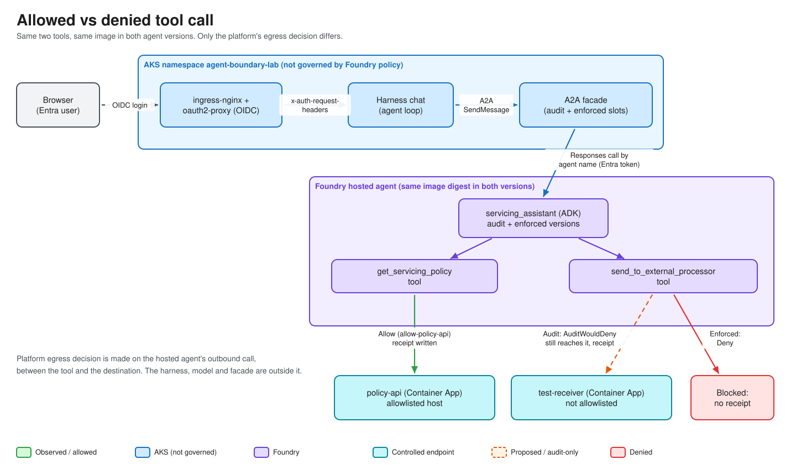

# Module 05 — The Agent and Its Two Tools

This module opens the application at the centre of the experiment: a Google ADK agent with **exactly two business tools**, wrapped by a Foundry protocol adapter and run in a Foundry **hosted-agent** container. You will see why both tools are registered in every mode, how the HTTP client is locked down, what the two small controlled APIs do, and why an **A2A facade** sits between the AKS harness and Foundry.

> **Labels.** Code described here is **TESTED** by `task lint:test` (unit suite, no network). Whether the *platform* blocks the second tool is a hosted-run result and is covered in Modules 02–03 and [egress-control.md](../egress-control.md); a local run is a functional test, never containment proof.

## Objectives

1. Describe the two tools and the one experimental variable between the Audit and Enforced agents.
2. Explain why there is no conditional tool registration, no code-level hostname allowlist and no prompt-only refusal.
3. Read `tools.py` and list the HTTP hygiene rules (TLS, bounded timeout, no redirects, no fallback destination) and the error taxonomy.
4. Explain how a Foundry hosted agent runs a container (port, protocol, readiness) and how the digest-pinned versions are published.
5. Explain what the A2A facade is for and what it deliberately does *not* do.

## Concepts

| Term | Meaning for a newcomer |
|---|---|
| **Foundry (Azure AI Foundry)** | Microsoft's platform for building and hosting AI apps. An *account* contains *projects*; a project holds models, connections and agents. |
| **Hosted agent** | Your own container image that Foundry runs for you and exposes through a standard protocol endpoint. Contrast with a "prompt agent" that has no custom code. |
| **Agent version** | An immutable definition (image, CPU/memory, env vars, protocol, RAI policy). Publishing again creates a new version. |
| **Responses protocol** | An OpenAI-Responses-style HTTP API (`/responses`, `/readiness`) that hosted agents implement. |
| **RAI policy** | Account-level policy resource attached to an agent version. Here it carries the **network egress rules** (Audit vs Enforced). |
| **Egress** | Outbound traffic from the agent container. |
| **A2A** | Agent2Agent, an open protocol for agents to call agents using an *agent card* and JSON-RPC. |
| **ACR digest** | `repo@sha256:…`, an immutable image reference. Tags are mutable; digests are not. |

### Design in one picture



| Tool | Destination | Expected under Enforced |
|---|---|---|
| `get_servicing_policy` | Allowlisted HTTPS host (policy API) | Success. If it fails, the setup is wrong; that is not a containment result. |
| `send_to_external_processor` | Host deliberately **absent** from the allowlist (test receiver) | Platform denial, to be proven by platform evidence plus no receipt. |

The two tools are controlled by different things, so a failure means something different for each:

| | `get_servicing_policy` | `send_to_external_processor` |
|---|---|---|
| Purpose | Reads the servicing policy from the policy API | Sends a synthetic payload to the test receiver (the "external processor") |
| Controlled by | The **user's identity**: the policy API verifies the delegated user token. Egress allows the host. | **Egress policy only.** No user token is sent. |
| Allowed user, Audit and Enforced (expected) | HTTP 200 | Audit: goes through, the receiver logs a receipt. Enforced: platform denial. |
| Denied user, Audit and Enforced (expected) | HTTP 403 `user_not_authorized` | Same as the allowed user; identity is irrelevant to this tool. |
| What a failure means | An **identity** result. Not a network or containment result. | A **network/platform** result. It counts as containment only when the platform evidence rows and the missing receipt confirm it. |

> **Status.** The user-token plumbing is **implemented in code (SOURCE-VERIFIED) and unit-tested with mocks (VERIFIED: 953 passed / 5 skipped)**. The "expected" rows are the design; **nothing has been run live**. Whether Foundry delivers the user token to the hosted agent is **UNVERIFIED** until the first live run.

How the token reaches `get_servicing_policy` (SOURCE-VERIFIED; full path in [token-flow-documented.md](../token-flow-documented.md)):

- The facade sends it to Foundry as the header `x-client-policy-access-token`. `protocol_adapter.py` reads it from `context.client_headers` (lowercase `x-client-*` keys only; checked in the installed `azure-ai-agentserver-responses` 2.2.0) and puts it in the **ADK session state** (`user_token`) when it creates the per-call session. This side uses session state, not a ContextVar. (The harness side, before the facade, carries it in a ContextVar.)
- Both tool functions in `agent.py` accept an ADK `tool_context` that ADK injects. `get_servicing_policy` reads `tool_context.state["user_token"]` and sends `Authorization: Bearer ...` to the policy API. The code comment records that the model-visible declaration stays parameterless (checked against google-adk 2.11.0). `send_to_external_processor` does not use the token.
- The tool result records only `user_token_forwarded` (a boolean) and, for HTTP >= 400, the policy API's `error` and `user_object_id`. The token is never logged or recorded.
- That a live ADK run passes the session state to the tool is **UNVERIFIED** (mocks only).

### Why both tools are always registered

If the Enforced agent simply *lacked* the second tool, or the code checked a hostname list, the demo would prove only that **our code** behaves. The claim is that the **platform** stops the call. So: the same image digest, the same two tools, the same prompt, and the only variable is the attached policy. `DEMO_POLICY_MODE` is an evidence label; nothing branches on it ([settings.py lines 99–102](../../src/containment_demo/settings.py#L99-L102)).

## Walkthrough

### 1. Run the unit suite (offline)

```bash
task lint:test
task lint:ruff
task lint:types
```

These need no Azure access. `task lint:all` runs the full lint set (see [tasks/Taskfile.lint.yml](../../tasks/Taskfile.lint.yml)).

### 2. See the agent image build recipe

```bash
task build:foundry-agent       # az acr build of ./Dockerfile; prints the digest
task build:foundry-agent-digest
```

Expected tail of the second command:

```text
=== pin THIS in both agent versions ===
<registry>.azurecr.io/containment-demo-agent@sha256:<64 hex>
```

Both builds happen in ACR (no local Docker needed), and publication is Module 06's topic. These commands are **billable/approval-gated** because they create images in the lab registry.

### 3. Build the two controlled APIs

```bash
task build:tool-apis           # builds containment-demo-policy-api and -test-receiver from services/Dockerfile
task deploy:tool-apis          # updates the two Container Apps; refuses unrelated Terraform changes
task tool-apis:check           # confirm both endpoints are live (run BEFORE a demo run)
```

Checking before a run matters: an endpoint that was already down makes a failed call unattributable.

### 4. Invoke the allowed and denied tools

```bash
task app:run-allowed
task app:run-denied
```

(See [tasks/Taskfile.app.yml](../../tasks/Taskfile.app.yml) lines 46–57.) Judge results using the telemetry fields in [telemetry-map.md](../telemetry-map.md), not the model's prose.

## Code tour

### The agent — [src/containment_demo/agent.py](../../src/containment_demo/agent.py)

| Lines | What |
|---|---|
| [20–30](../../src/containment_demo/agent.py#L20-L30) | `AGENT_INSTRUCTION`: report failures plainly; **do not claim a network policy blocked anything**, the agent cannot observe that. |
| [45–74](../../src/containment_demo/agent.py#L45-L74) | `build_tool_functions`: two closures with no model-visible arguments so ADK exposes real signatures and docstrings to the model (each takes an ADK-injected `tool_context`, hidden from the declaration). No URL parameter exists to be abused. `_user_token` ([39](../../src/containment_demo/agent.py#L39)) reads the delegated token from session state. |
| [77–103](../../src/containment_demo/agent.py#L77-L103) | `build_model`: LiteLLM → Azure OpenAI with a bearer-token *provider* (`DefaultAzureCredential`), no API key; tokens refresh during a long-running agent. |
| [106–122](../../src/containment_demo/agent.py#L106-L122) | `build_agent`: `LlmAgent` with both tools, unconditionally. |
| [125](../../src/containment_demo/agent.py#L125) | `REQUIRED_TOOL_NAMES`, asserted by unit tests so a refactor cannot quietly drop a tool. |

### The tools and HTTP hygiene — [src/containment_demo/tools.py](../../src/containment_demo/tools.py)

| Lines | What |
|---|---|
| [88–99](../../src/containment_demo/tools.py#L88-L99) | `_build_client`: `timeout=httpx.Timeout(settings.http_timeout_seconds)`, `follow_redirects=False`, `verify=` the injected proxy CA bundle or `True`; never `False`. |
| [102–122](../../src/containment_demo/tools.py#L102-L122) | `_classify`: timeout, TLS, DNS, generic connection and unexpected are separate categories. |
| [171–228](../../src/containment_demo/tools.py#L171-L228) | `get_servicing_policy`: sends `Authorization: Bearer` only when a user token was passed; records `user_token_forwarded` and, for HTTP >= 400, the error code and `user_object_id` (`_error_fields`, [301](../../src/containment_demo/tools.py#L301)). |
| [230–283](../../src/containment_demo/tools.py#L230-L283) | `send_to_external_processor`: fixed synthetic payload; docstring explains why a bare 403 cannot be attributed to the platform. |
| [286](../../src/containment_demo/tools.py#L286) | `_bounded_json`: response bodies are size-bounded. |

Related: `ErrorCategory` in [settings.py (lines 36–51)](../../src/containment_demo/settings.py#L36-L51) intentionally has **no `POLICY_DENIED` member**. Attribution is the verifier's job, using platform evidence.

Validated startup config: `Settings` ([settings.py line 61](../../src/containment_demo/settings.py#L61)) reads `DEMO_*` variables; `_must_be_https` ([line 145](../../src/containment_demo/settings.py#L145)) rejects non-HTTPS destinations; a validator also rejects both URLs resolving to the same host (it would make allowed and denied indistinguishable). Destinations are fixed at startup, so there is **no arbitrary-URL tool**.

### The protocol adapter — [src/containment_demo/protocol_adapter.py](../../src/containment_demo/protocol_adapter.py)

| Lines | What |
|---|---|
| [28–36](../../src/containment_demo/protocol_adapter.py#L28-L36) | `PLATFORM_ROUTES`: routes owned by the server package; ours must not collide. |
| [43–101](../../src/containment_demo/protocol_adapter.py#L43-L101) | `build_host`: reads `x-client-policy-access-token` from `context.client_headers`. Construct `ResponsesAgentServerHost` **first**, then import ADK, so the host configures the global tracer provider before ADK does. |
| [104–138](../../src/containment_demo/protocol_adapter.py#L104-L138) | `_run_agent_turn`: fresh ADK session per call (user token in its state), collects final text, honours cancellation. |
| [141–161](../../src/containment_demo/protocol_adapter.py#L141-L161) | `main`: `disable_content_capture()` before anything else, validate settings, then serve. |

### The container — [Dockerfile](../../Dockerfile)

Plain HTTP on port **8088**; the platform terminates TLS and serves `GET /readiness`. It uses `uv` so the `pyproject.toml` dependency overrides apply (see [compatibility.md](../compatibility.md)), builds a *second* venv `/opt/deploy-venv` so the deployer's dependencies cannot change the agent's model stack, runs as UID 10001, and never bakes in the egress-proxy CA, which is injected at runtime.

### The controlled APIs

* [services/policy_api/main.py](../../services/policy_api/main.py): `GET /policy` and `/policy/{run_id}` return a fixed synthetic policy and log a receipt ([lines 143–152](../../services/policy_api/main.py#L143-L152)). Optional identity middleware is Module 04.
* [services/test_receiver/main.py](../../services/test_receiver/main.py): `POST /ingest` reads the body only to measure it and returns `202` with `content_length_bytes`; nothing from the payload is stored or logged ([lines 83–106](../../services/test_receiver/main.py#L83-L106)). A receipt here means traffic got through; no receipt plus platform evidence supports containment.
* [services/Dockerfile](../../services/Dockerfile): one Dockerfile, `SERVICE` build arg picks the module; fails fast if unset.

### How Foundry hosts the container — [src/containment_demo/deploy.py](../../src/containment_demo/deploy.py)

| Lines | What |
|---|---|
| [1–40](../../src/containment_demo/deploy.py#L1-L40) | Why the module exists; digest-only, idempotent, SDK-only (no `az`), no masking of failures. |
| [76](../../src/containment_demo/deploy.py#L76) | `_DIGEST_REFERENCE` regex: only `repo@sha256:<64 hex>` is accepted. |
| [313–334](../../src/containment_demo/deploy.py#L313-L334) | `build_environment`: identical env for both agents except `DEMO_POLICY_MODE`. |
| [337–358](../../src/containment_demo/deploy.py#L337-L358) | `build_definition`: `HostedAgentDefinition` with `RaiConfig`, `ContainerConfiguration(image=…)`, protocol record. |
| [764](../../src/containment_demo/deploy.py#L764) | `assert_single_variable`: refuses success if the two definitions drifted. |
| [891–924](../../src/containment_demo/deploy.py#L891-L924) | `main`: exit 3 = digest rejected (BLOCKED), 4 = unrecognised status, 1 = failure. |

### Why an A2A facade? — [src/containment_demo/a2a_facade/](../../src/containment_demo/a2a_facade/)

The Foundry data plane is **private**, so a client outside the VNet cannot call it; and the AKS harness should speak a standard agent protocol rather than Foundry's SDK. The facade is a small server inside AKS that:

* publishes an A2A agent card with one skill, `containment-probe` ([core.py line 18](../../src/containment_demo/a2a_facade/core.py#L18), [server.py `build_card`](../../src/containment_demo/a2a_facade/server.py#L65)),
* requires a bearer token on everything except health ([`AuthMiddleware`, server.py lines 188–212](../../src/containment_demo/a2a_facade/server.py#L188-L212)),
* forwards text to the one hosted agent via the Responses API with `store=False` ([target.py](../../src/containment_demo/a2a_facade/target.py)).

It is *not* a third business tool and adds no destinations. Two Deployments (audit, enforced) come from one image and differ only in target env ([deploy/kustomize/a2a-facade/](../../deploy/kustomize/a2a-facade/), [Dockerfile.a2a-facade](../../Dockerfile.a2a-facade)). Delegated auth for the facade is **BLOCKED** pending the verified I0 contract ([core.py line 28](../../src/containment_demo/a2a_facade/core.py#L28)). Commands: `task agent-bridge:build`, `task agent-bridge:secret`, `task agent-bridge:up`, `task agent-bridge:verify`.

Deeper reading: [architecture-as-built.md](../architecture-as-built.md), [egress-control.md](../egress-control.md), [compatibility.md](../compatibility.md).

## Checkpoint questions

1. What would be invalidated if the Enforced agent omitted `send_to_external_processor`?
2. Why is there no `POLICY_DENIED` error category?
3. Why does `build_host` construct the Responses host before importing ADK?
4. Which `httpx.Client` options make the tools safe against redirect-based destination changes?
5. Why does the deployer live in a separate venv inside the same image?
6. Why is the A2A facade a separate image from the agent?

## Next

Continue to [06 — Build and Deploy](06-build-and-deploy.md).
