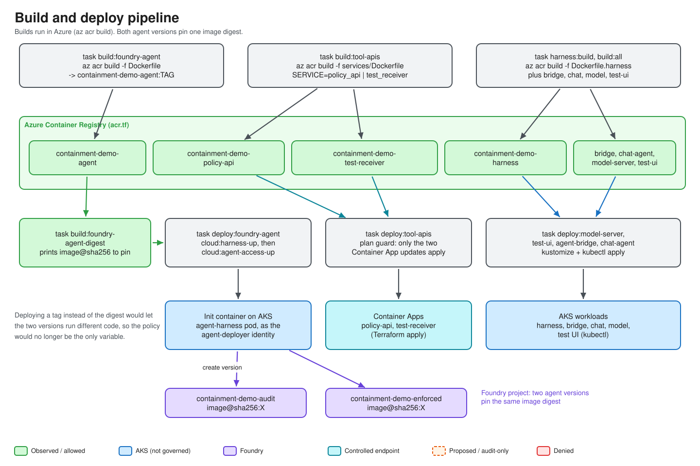

# Module 06 — Build and Deploy

This module takes the code from Module 05 to a running lab: images built **in Azure** (ACR), manifests rendered with Kustomize and applied to AKS, Secrets created without ever printing them, and **two Foundry agent versions — Audit and Enforced — published from the same image digest**.

> **Labels.** Every command here that builds, applies or publishes is **approval-gated and billable**; the repo rule is to get owner approval before creating billable resources, changing Azure policies or publishing images. The read-only/dry-run variants (`render`, `plan`, `status`) are safe. Build and deploy behaviour is described from the Taskfiles in this repository; end-to-end hosted results are **OWNER-REPORTED**, see [architecture-as-built.md](../architecture-as-built.md).

## Objectives

1. Explain what ACR is and why builds run with `az acr build` rather than a local Docker daemon.
2. Map each Dockerfile to the component it builds and say why they are separate images.
3. Read the Kustomize layout and the `REPLACE_WITH_*` render step.
4. Explain each ingress annotation (timeouts, buffer size) and the problem it solves.
5. Create the harness and facade Secrets, including the optional diagnostics links, without exposing values.
6. Publish both Foundry agent versions and verify they pin the same digest.

## Concepts

| Term | Meaning |
|---|---|
| **ACR** (Azure Container Registry) | Private OCI registry. `az acr build` uploads the build context and builds remotely, so what runs is exactly what ACR built. |
| **AKS** | Managed Kubernetes. Pods here use workload identity (Module 04), not stored credentials. |
| **Kustomize** | Template-free manifest composition built into `kubectl`. Here, manifests contain `REPLACE_WITH_*` tokens that a task substitutes at render time; nothing rendered is written to disk or git. |
| **Container Apps** | Serverless containers hosting the two controlled tool APIs. |
| **Init container** | A container that must finish before the main pod starts. The agent-version publisher runs as one. |
| **Taskfile** | A YAML task runner (`task`); this repo wraps all az/kubectl/terraform steps in named tasks. |

### Why digests, not tags

Tags move. If the Audit and Enforced versions ran different code, the egress policy would stop being the only variable. So [tasks/Taskfile.build.yml](../../tasks/Taskfile.build.yml) (header comment, lines 17–25) says it outright: pin what `task build:foundry-agent-digest` prints. [deploy.py](../../src/containment_demo/deploy.py) enforces it by accepting only `repo@sha256:<64 hex>` ([line 76](../../src/containment_demo/deploy.py#L76)), with no tag fallback.

### Pipeline



## Walkthrough

### 1. Provision infrastructure (approval required)

```bash
task cloud:whoami          # confirm the Azure identity and subscription
task cloud:target-check
task cloud:plan
task cloud:up
```

Taskfile names are in [tasks/Taskfile.cloud.yml](../../tasks/Taskfile.cloud.yml) (`whoami` line 47, `target-check` 52, `plan` 105, `up` 114). `cloud:up` provisions ACR, AKS, Foundry, networking, policies and the Container Apps.

### 2. Build the images in ACR

```bash
task build:all             # all six components / seven images; deploys nothing
```

or one at a time:

| Task | Image / repository | Dockerfile |
|---|---|---|
| `task build:foundry-agent` | `containment-demo-agent` | [Dockerfile](../../Dockerfile) |
| `task build:tool-apis` | `containment-demo-policy-api`, `containment-demo-test-receiver` | [services/Dockerfile](../../services/Dockerfile) (`--build-arg SERVICE=…`) |
| `task build:agent-bridge` | A2A facade | [Dockerfile.a2a-facade](../../Dockerfile.a2a-facade) |
| `task build:chat-agent` | `containment-demo-harness` | [Dockerfile.harness](../../Dockerfile.harness) |
| `task build:model-server` | CPU llama.cpp + GGUF | [Dockerfile.local-model](../../Dockerfile.local-model) |
| `task build:test-ui` | two-button test page | [Dockerfile.demo-ui](../../Dockerfile.demo-ui) |

Print the digest the agent versions will pin:

```bash
task build:foundry-agent-digest
```

```text
=== pin THIS in both agent versions ===
<registry>.azurecr.io/containment-demo-agent@sha256:<64 hex>
```

> **Why `Dockerfile.harness` is pip-only.** The harness runs ADK on LiteLLM and is an A2A *client*; it must **not** contain the Foundry agent-server stack. It installs the project with `pip --no-deps`, then adds only what it needs (`google-adk`, `litellm`, `a2a-sdk`, `starlette`, `uvicorn`…) so `azure-ai-agentserver-*` is never pulled in. The agent image needs `uv` for a dependency override that only matters when the agent-server stack and ADK must co-install ([Dockerfile lines 20–23](../../Dockerfile#L20-L23)); the harness never installs that stack, so plain pip is enough. It also caps `protobuf<7` because `a2a-sdk` 1.0.2 fails on protobuf 7.x ([Dockerfile.a2a-facade](../../Dockerfile.a2a-facade) header records the symptom). See [Dockerfile.harness lines 1–7](../../Dockerfile.harness#L1-L7).

### 3. Deploy the application components

```bash
task deploy:tool-apis      # update both Container Apps; refuses non-application Terraform changes
task tool-apis:check       # both health endpoints must answer
task deploy:foundry-agent  # publish both agent versions (see below)
task deploy:model-server
task deploy:agent-bridge
task deploy:chat-agent
```

Or everything: `task deploy:all`. The whole flow from scratch: `task app:deploy` (see [tasks/Taskfile.app.yml](../../tasks/Taskfile.app.yml) lines 14–19), or `task app:deploy-external HOSTNAME=… LETSENCRYPT_EMAIL=…` to add the Entra-protected ingress.

Dry runs for each component:

```bash
task chat-agent:render     # print substituted manifests, no secrets in them
task chat-agent:plan       # server-side dry run
task agent-bridge:plan
task model-server:plan
```

### 4. Secrets — never on a command line

```bash
task agent-bridge:secret   # random facade bearer token; kept unless ROTATE=1
task chat-agent:secret     # harness UI token + optional diagnostics links
task chat-agent:token      # PRINTS the harness token (deliberate, owner only)
```

`chat-agent:secret` ([Taskfile.harness.yml lines 60–91](../../tasks/Taskfile.harness.yml#L60-L91)) writes the token through a temp file, not argv, so it never shows in `ps`. If any of these are set in your shell or `.env`, they are added to the same Secret and the Deployment is restarted:

```bash
HARNESS_WORKBOOK_URL=<workbook-url> \
HARNESS_LOGS_URL=<log-analytics-url> \
HARNESS_APPINSIGHTS_URL=<app-insights-url> \
task chat-agent:secret
```

They become the **Diagnostics** chips in the UI (Module 07). Missing values simply hide the chip; the harness never fabricates a link. For the OIDC secret see Module 04 (`task chat-agent:external-secret`).

### 5. Publish the two Foundry agent versions

`task deploy:foundry-agent` ([Taskfile.deploy.yml lines 72–81](../../tasks/Taskfile.deploy.yml#L72-L81)) runs `cloud:harness-up`, waits for `deployment/agent-harness` to roll out, then runs `cloud:agent-access-up` to grant model access. The pod's **init container** runs `/opt/deploy-venv/bin/python -m containment_demo.deploy` from the *same agent image*, because the Foundry data plane is private and only reachable from inside the VNet. The deployer:

1. builds both `HostedAgentDefinition`s from one source,
2. attaches the Audit RAI policy to one and the Enforced policy to the other,
3. creates the versions (reusing a matching version, so restarts are idempotent),
4. waits until both are active and reads them back,
5. refuses success if anything but the policy differs.

Useful follow-ups:

```bash
task foundry-agent:plan      # server-side dry run of the publisher
task foundry-agent:status    # publisher pod and its init-container result
task chat-agent:network-state   # READ-ONLY: managed network, both policies, policy on each version
task foundry-agent:down      # removes the publisher and namespace; published versions remain
```

Exit codes from `deploy.py`: `0` ok, `1` failure, `3` digest rejected (**BLOCKED**, stop and record), `4` unrecognised status (**BLOCKED**). Both versions pass or the run does not count.

## Code tour

### Kustomize layout — [deploy/kustomize/](../../deploy/kustomize/)

| Directory | Contents |
|---|---|
| [base/](../../deploy/kustomize/base/) | namespace, ServiceAccount, `deployment.yaml` (the `agent-harness` pod whose init container publishes the agent versions), Secret placeholder. |
| [a2a-facade/](../../deploy/kustomize/a2a-facade/) | `base/` plus `audit/` and `enforced/` overlays: one image, two Deployments differing only by target env. |
| [harness/](../../deploy/kustomize/harness/) | The chat service, ClusterIP only. |
| [harness-external/](../../deploy/kustomize/harness-external/) | oauth2-proxy, two Ingresses, ClusterIssuer (Module 04). |
| [local-model/](../../deploy/kustomize/local-model/) | CPU model server (Module 07). |
| [demo-ui/](../../deploy/kustomize/demo-ui/) | Two-button test page. |

Common pod hardening: `runAsNonRoot`, `allowPrivilegeEscalation: false`, `readOnlyRootFilesystem: true`, `capabilities.drop: ["ALL"]`, and `automountServiceAccountToken: false` where no Kubernetes API access is needed (see [harness/deployment.yaml lines 19–25, 63–67](../../deploy/kustomize/harness/deployment.yaml#L19-L25)).

Render step: [Taskfile.harness.yml `render`](../../tasks/Taskfile.harness.yml#L325) substitutes `REPLACE_WITH_NAMESPACE`, `…_HARNESS_IMAGE`, `…_AGENT_NAME_*` with `sed`, then fails if any `REPLACE_WITH_*` token is left over.

### Ingress annotations — [ingress-harness.yaml](../../deploy/kustomize/harness-external/ingress-harness.yaml) and [ingress-oauth2.yaml](../../deploy/kustomize/harness-external/ingress-oauth2.yaml)

| Annotation | Value | Why |
|---|---|---|
| `proxy-read-timeout` | `300` | ingress-nginx defaults to 60 s. Model turns can take 40–70 s on CPU ([harness settings comment](../../src/containment_demo/harness/settings.py#L38)) and the websocket is long-lived; 60 s would cut slow turns. |
| `proxy-send-timeout` | `300` | Same reasoning for the upstream direction. |
| `proxy-connect-timeout` | `30` | Fail fast if the harness pod is not reachable. |
| `proxy-buffer-size` (oauth2 ingress) | `16k` | Entra sign-in sets large session cookies and headers; the default nginx proxy buffer is small (4k or 8k depending on platform), and an overflow typically surfaces as a 502 on the OAuth callback. The repo sets 16k on the `/oauth2` ingress; the failure mode itself is general nginx behaviour, not separately tested here. |
| `auth-url` / `auth-signin` / `auth-response-headers` | oauth2-proxy URLs | Authenticate every request and forward `x-auth-request-*` identity headers. |

The `/ws` handler sends a `progress` event every 5 s, so an open websocket is never idle for 300 s while a turn runs ([chat.py lines 365–388](../../src/containment_demo/harness/chat.py#L365-L388)).

### Build and publish tasks

* [tasks/Taskfile.build.yml](../../tasks/Taskfile.build.yml): `foundry-agent` (48), `tool-apis` (63), `all` (86), `foundry-agent-digest` (116), `check-endpoints` (153).
* [tasks/Taskfile.deploy.yml](../../tasks/Taskfile.deploy.yml): `all` (11), `tool-apis` (30), `foundry-agent` (72), `chat-agent` (104).
* [tasks/Taskfile.harness.yml](../../tasks/Taskfile.harness.yml): `build` (27), `secret` (60), `up` (373), `open` (437), `verify` (447).
* [tasks/Taskfile.a2a.yml](../../tasks/Taskfile.a2a.yml): `build` (32), `secret` (65), `up` (152), `verify` (179).

Deeper reading: [architecture-as-built.md](../architecture-as-built.md), [compatibility.md](../compatibility.md), [rebuild-runbook.md](../rebuild-runbook.md).

## Checkpoint questions

1. What breaks in the experiment if you publish an agent version by tag?
2. Why does the publisher run inside the cluster rather than from your laptop?
3. Which annotation would you inspect for a 502 on `/oauth2/callback`? For a cut-off slow model turn?
4. Why is `Dockerfile.harness` a separate, pip-only image rather than reusing the agent image?
5. How do the diagnostics URLs reach the UI without being baked into an image or a manifest?

## Next

Continue to [07 — The Harness UI](07-harness-ui.md).
