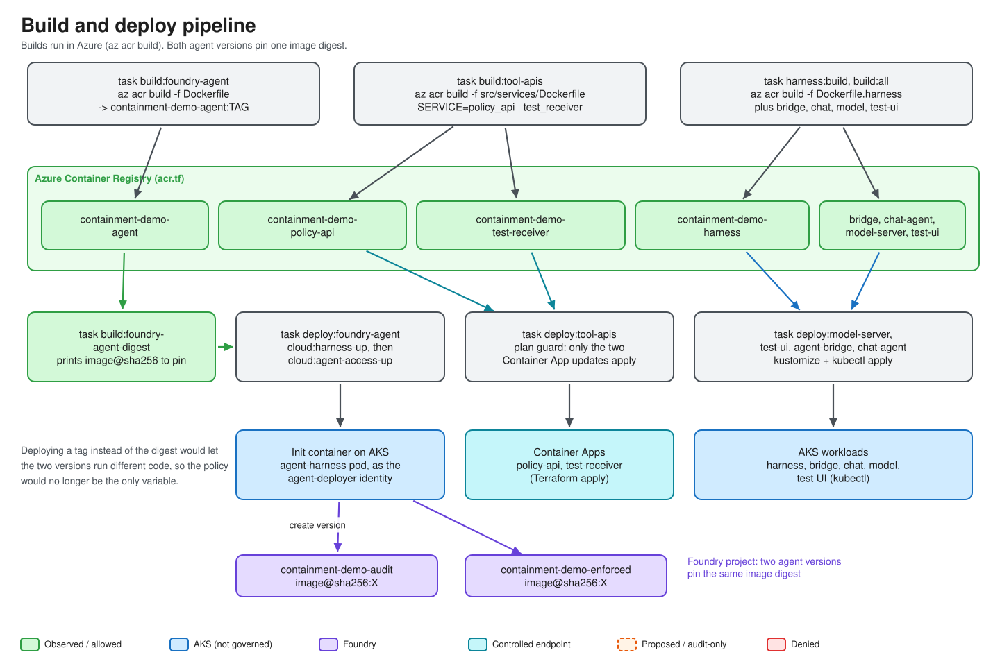

# 06: Build and deploy

Use the [deployment guide](../rebuild-runbook.md#2-build-and-deploy-the-applications)
for the command sequence. Builds run in ACR; no local Docker is needed.



## What gets built

| Component | Dockerfile |
| --- | --- |
| Foundry agent | [Dockerfile](../../Dockerfile) |
| Policy API and receiver | [src/services/Dockerfile](../../src/services/Dockerfile) |
| A2A bridges | [Dockerfile.a2a-facade](../../Dockerfile.a2a-facade) |
| Browser harness | [Dockerfile.harness](../../Dockerfile.harness) |
| CPU model server | [Dockerfile.local-model](../../Dockerfile.local-model) |
| Two-button UI | [Dockerfile.demo-ui](../../Dockerfile.demo-ui) |

Six build targets produce seven images because the two APIs share a Dockerfile.
The Copilot extension has separate image/build tasks.

## Why the agent uses a digest

A tag can move. A digest identifies the exact image.
The deployer accepts `repo@sha256:<64 hex>` and verifies that the Audit and
Enforced versions match apart from their intended policy/labels.

The private AKS publisher creates or reuses matching versions, waits for readiness,
and grants the agent identities model access.

## Kubernetes manifests

[deploy/kustomize](../../deploy/kustomize/) contains the harness, bridges,
model server, test UI, and external ingress. Tasks substitute deployment settings
and reject unresolved placeholders before applying.

Secrets are created separately and reused unless rotation is requested.
The pods run non-root with read-only filesystems and a writable `/tmp` volume.

## Inspect the result

```bash
task foundry-agent:status
task build:foundry-agent-digest
task chat-agent:network-state
```

An active agent is ready for a test; it is not evidence that the test passed.

**Next:** [07: External access](07-external-access.md)
