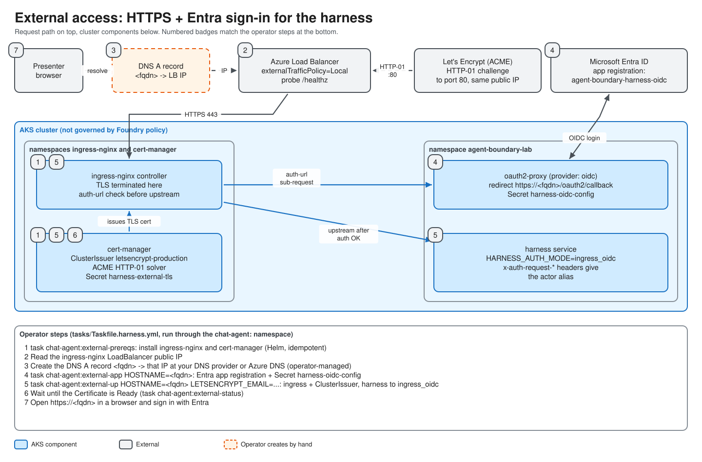

# 07: External access

Follow [HTTPS and sign-in setup](../rebuild-runbook.md#3-set-up-https-and-user-sign-in)
in the deployment guide. You need a hostname you control and access to its DNS.



## The request path

```text
Public hostname -> Azure load balancer -> ingress-nginx
  -> Entra sign-in through oauth2-proxy -> harness
```

cert-manager obtains the Let's Encrypt certificate. The HTTP-01 challenge
needs DNS pointing at the ingress IP and inbound port 80. The site uses port 443.
The `/oauth2` route must work before sign-in; the harness route requires a session.

## What setup automates

The bootstrap installs ingress/certificate components, creates the sign-in and
policy API registrations, configures delegated access, writes the Kubernetes
Secret, and applies the external ingress.

It also writes policy API settings into `.env`; the deployment guide's final
apply makes those settings active.

The DNS record is yours to create. After a cluster rebuild, check the new
ingress IP and update the record before requesting the certificate.

## Check readiness

```bash
task chat-agent:external-status
```

Wait for `harness-external-tls` to show `READY=True`, then open your HTTPS URL.
Signing in does not grant policy access; the policy API makes that decision.

[Login/certificate troubleshooting](12-troubleshooting.md#ingress-and-sign-in)

**Next:** [08: Harness UI](08-harness-ui.md)
