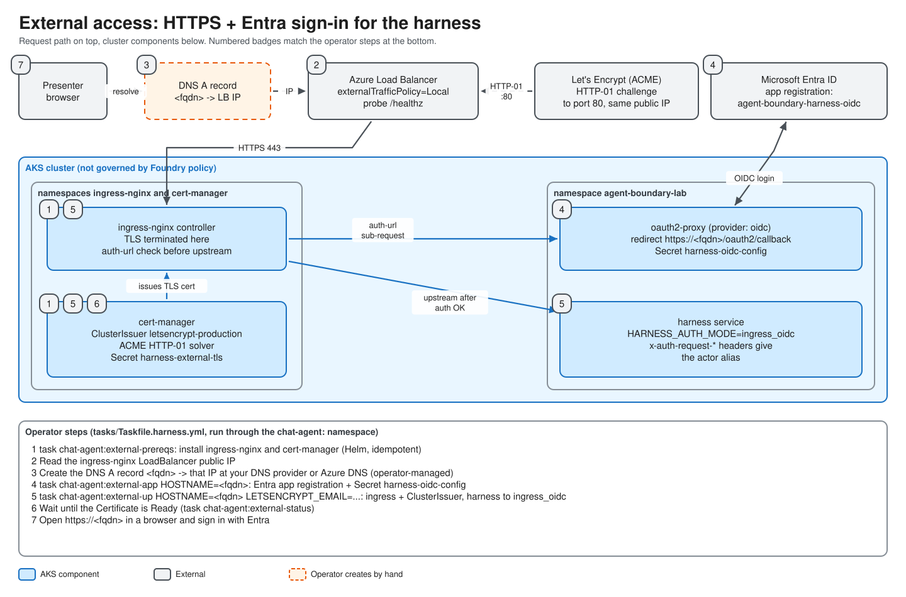

# Module 07 — External access: domain, DNS, TLS and Entra login

Up to Module 06 the harness is reachable only from inside the cluster (`ClusterIP`) or through `kubectl port-forward`. That is fine for development, but a presenter on a conference-room laptop needs a real URL, a real certificate and a real sign-in. This module builds that path: **public DNS name → Azure load balancer → ingress-nginx → TLS from Let's Encrypt → Entra OIDC login → harness**.

> **Status:** the task flow below is **TESTED** in the owner's environment (external HTTPS and Entra sign-in reached the harness and produced the allowed-vs-denied output, 2026-10-20). The DNS provider steps are generic because the lab does not create DNS for you; the commands shown for reading the IP and checking DNS are standard `kubectl`/`dig` usage and have not been run against a specific provider here.

## Objectives

1. Explain what each piece of the external path does and why it is needed.
2. Choose a hostname, create the DNS `A` record, and verify it before requesting a certificate.
3. Run the external bootstrap tasks in a safe order.
4. Verify the certificate, the Entra app registration and the signed-in harness.
5. Know which parts are rebuilt every time (IP, certificate) and which persist (your domain).

## Concepts

| Term | Meaning for this lab |
| --- | --- |
| **FQDN / hostname** | The name presenters type, for example `demo.contoso-lab.com`. You own the parent domain; passed to tasks as `HOSTNAME`. |
| **DNS `A` record** | Maps the hostname to an IPv4 address. Here: the public IP of the ingress-nginx load balancer. |
| **Ingress / ingress controller** | A Kubernetes `Ingress` is a routing rule; an ingress controller (ingress-nginx) is the pod that enforces it and listens on the public IP. |
| **Azure Load Balancer** | AKS creates one when a Service has `type: LoadBalancer`. It owns the public IP. |
| **cert-manager** | A cluster add-on that requests and renews TLS certificates and stores them as Secrets. |
| **ClusterIssuer** | The cert-manager object describing *who* issues certs. Here: Let's Encrypt production, using the **HTTP-01** challenge. |
| **HTTP-01 challenge** | Let's Encrypt fetches a token over **plain HTTP port 80** at your hostname to prove you control it. DNS must already point at the cluster. |
| **OIDC** | OpenID Connect: the sign-in protocol on top of OAuth 2.0. Entra ID is the identity provider. |
| **oauth2-proxy** | A small reverse proxy that performs the OIDC login. ingress-nginx asks it "is this request signed in?" before forwarding to the harness (the `auth-url` pattern). |
| **App registration** | The Entra definition of the OIDC client (client ID, redirect URI). `external-app` creates it for you. |



## What gets built

| Component | Created by | Namespace |
| --- | --- | --- |
| ingress-nginx (class `nginx`, `externalTrafficPolicy=Local`, probe path `/healthz`) | `chat-agent:external-prereqs` (Helm) | `ingress-nginx` |
| cert-manager (CRDs enabled) | `chat-agent:external-prereqs` (Helm) | `cert-manager` |
| Entra app registration `agent-boundary-harness-oidc` + service principal | `chat-agent:external-app` (`az ad app create`) | tenant |
| Secret `harness-oidc-config` (client id/secret, cookie secret, issuer, redirect URL, `OAUTH2_PROXY_SCOPE`, and `HARNESS_OBO_*` keys for issue #4; the harness Deployment maps just the four `HARNESS_OBO_*` keys with optional `secretKeyRef`, and `external-app` restarts it; UNVERIFIED live) | `chat-agent:external-app` | lab namespace |
| Issue #4: Entra app B `agent-boundary-policy-api` (scope `policy.read`), scope `access_as_user` on app A, `requiredResourceAccess`, tenant-wide consent (via `az ad` / `az rest` to Graph) | `chat-agent:external-app` | tenant |
| `ClusterIssuer`, `harness-oauth2-proxy` Deployment/Service, two Ingresses | `chat-agent:external-up` (kustomize) | lab namespace |
| Certificate `harness-external-tls` | cert-manager (automatic) | lab namespace |
| DNS `A` record | **You** | your DNS provider |

## Walkthrough

### 1. Choose the hostname

Pick a name under a domain you control, for example `harness.<your-domain>`. It must be reachable on the public internet (Let's Encrypt validates from outside). Use a dedicated subdomain so a single record is all you manage.

Set it once in your shell for the commands below:

```bash
export HOSTNAME=harness.example.com            # your fqdn
export LETSENCRYPT_EMAIL=you@example.com       # ACME account / expiry notices
```

> The Taskfiles read `HOSTNAME` and `LETSENCRYPT_EMAIL` as **Task variables**, so pass them on the command line as shown in the tasks below (`task … HOSTNAME=$HOSTNAME …`). `.env.example` lists `EXTERNAL_HOSTNAME`, but no task reads it.

### 2. Provision the cluster

```bash
task cloud:up
```

You need a running AKS cluster before any ingress work (Module 03).

### 3. Install ingress-nginx and cert-manager

```bash
task chat-agent:external-prereqs
```

This runs `helm upgrade --install` for both charts and waits for their rollouts ([Taskfile.harness.yml lines 127–165](../../tasks/Taskfile.harness.yml)). It is idempotent. Two settings matter:

- `controller.service.externalTrafficPolicy=Local` and the Azure LB health probe annotation `/healthz`: without them the Azure load balancer can mark the backend unhealthy. See [Module 12](12-troubleshooting.md).
- `controller.ingressClassResource.default=false`: the ingress class is explicit (`nginx`), so nothing else in the cluster silently adopts it.

### 4. Read the load balancer's public IP

ingress-nginx's Service is `ingress-nginx-controller` in namespace `ingress-nginx`:

```bash
kubectl -n ingress-nginx get svc ingress-nginx-controller \
  -o jsonpath='{.status.loadBalancer.ingress[0].ip}{"\n"}'
```

```text
20.x.x.x
```

If it prints nothing, wait a minute and run it again; Azure is still allocating the address.

### 5. Create the DNS record

At your DNS provider create:

| Type | Name | Value | TTL |
| --- | --- | --- | --- |
| `A` | `harness` (or your chosen label) | the IP from step 4 | 300 s or lower |

If your zone is in **Azure DNS**, the equivalent is:

```bash
az network dns record-set a add-record \
  --resource-group <dns-zone-resource-group> --zone-name <your-domain> \
  --record-set-name harness --ipv4-address <ip-from-step-4>
```

Keep the TTL low: **the IP changes every time the cluster is rebuilt** (a new load balancer gets a new public IP), so on each rebuild you update this one record. *(Expected from how AKS allocates public IPs; not separately measured.)*

Verify before you continue. Let's Encrypt will fail the challenge, and may rate-limit you, if the name does not resolve to the cluster yet:

```bash
dig +short $HOSTNAME
```

```text
20.x.x.x        # must equal the IP from step 4
```

### 6. Deploy the application and enable external ingress

```bash
task deploy:app-components
task chat-agent:external-bootstrap HOSTNAME=$HOSTNAME LETSENCRYPT_EMAIL=$LETSENCRYPT_EMAIL
```

`external-bootstrap` runs, in order ([Taskfile.harness.yml lines 232–245](../../tasks/Taskfile.harness.yml)):

1. `external-prereqs` (a no-op if step 3 already ran),
2. `external-app`: creates or updates the Entra app registration with redirect URI `https://<fqdn>/oauth2/callback`, enables ID-token issuance, creates the service principal, creates a client secret and a cookie secret, and writes Secret `harness-oidc-config`. Re-runs **reuse** the existing secrets unless the app id changed or you set `ROTATE_OIDC_SECRET=1`,
   Since issue #4 it **also** (SOURCE-VERIFIED in the task; **UNVERIFIED, never run**) creates app B and its `policy.read` scope, publishes `access_as_user` on app A, sets app A's `requiredResourceAccess`, grants tenant-wide consent for both scopes via Graph, sets `OAUTH2_PROXY_SCOPE` to `openid profile email offline_access api://<A>/access_as_user`, and writes the `TF_VAR_policy_api_*` lines into `.env` (see below),
3. `external-up`: renders the kustomize overlay with your hostname and applies it, then sets `HARNESS_AUTH_MODE=ingress_oidc` on the harness Deployment and waits for both rollouts,
4. `external-status`.

`external-up` now refuses to run if the Secret has no `OAUTH2_PROXY_SCOPE` (run `external-app` first). oauth2-proxy runs with `--pass-access-token=true` and the ingress forwards `x-auth-request-access-token` with `proxy-buffer-size: 16k`; whether v7.7.1 and 16k behave as intended is **UNVERIFIED**.

The all-in-one from-scratch form is:

```bash
task app:deploy-external HOSTNAME=$HOSTNAME LETSENCRYPT_EMAIL=$LETSENCRYPT_EMAIL
```

It runs `cloud:up`, `deploy:app-components`, `chat-agent:external-bootstrap` ([Taskfile.app.yml lines 20–31](../../tasks/Taskfile.app.yml)), which itself runs `external-app`, and finally a second `cloud:up`. **Do not run `chat-agent:external-app` again as a separate step**; it is already inside. `external-app` writes the `TF_VAR_policy_api_*` lines into `.env`, and the final `cloud:up` applies them. The IP does not exist until ingress-nginx is installed, so on a **first** build the DNS record cannot be created in advance. Two options: use the split sequence above (recommended: DNS exists before the certificate is requested), or run the all-in-one task, create the record as soon as the IP appears, and let cert-manager retry the challenge.

Preview first if you wish (nothing is applied):

```bash
task chat-agent:external-render HOSTNAME=$HOSTNAME LETSENCRYPT_EMAIL=$LETSENCRYPT_EMAIL
task chat-agent:external-plan   HOSTNAME=$HOSTNAME LETSENCRYPT_EMAIL=$LETSENCRYPT_EMAIL
```

`external-render` refuses to print if any `REPLACE_WITH_*` placeholder is left unsubstituted ([lines 247–269](../../tasks/Taskfile.harness.yml)).

#### Issue #4 follow-up: the policy API switch to delegated auth (UNVERIFIED, never run)

Put `POLICY_API_AUTHORIZED_USER_IDS=8bbab162-0743-444c-b305-fed34bab43fb` in `.env` **only**; `10870cbe-74ab-4c46-b5a8-8fcded26e615` must be absent (that absence is what denies it). Both `app:deploy-external` and `external-app` refuse to start without it. `external-app` writes the six `TF_VAR_policy_api_*` lines into `.env`, and `app:deploy-external` runs the second `cloud:up` that applies them. Nothing is copied by hand. If you run the split sequence instead, run `task cloud:up` yourself after `external-app`.

1. `uv lock` (msal was added to `pyproject.toml`; `uv.lock` is tracked and not regenerated).
2. Build and roll out the new images so the code ships (see [token-flow-documented.md](../token-flow-documented.md) section 8). Images are built by `task build:*`; `deploy:app-components` does not build.

Owner approval is required for every step. These tasks use the `az` CLI, an exception to the squad rule "no az in anything that ships" made at the owner's explicit request. Three code defects found in review that can stop this working are listed in token-flow section 6.

### 7. Wait for the certificate

```bash
task chat-agent:external-status
```

```text
NAME                    READY   AGE
harness-external-tls    True    2m
```

`READY=False` for a few minutes is normal while Let's Encrypt validates. If it stays `False`, jump to the troubleshooting table in [Module 12](12-troubleshooting.md) (DNS, port 80, rate limits).

### 8. Sign in

Browse to `https://<your-fqdn>`. You are redirected to Microsoft, then back to the harness. The page header shows your identity and, in ingress mode, a **Logout** chip (Module 08). Run the allowed and denied users per Module 09.

### 9. Optional: diagnostics links

Add the three `HARNESS_*_URL` values to `.env` and run `task chat-agent:secret` ([Module 06](06-build-and-deploy.md)).

### 10. Remove the external path

```bash
task chat-agent:external-down
```

This deletes the two Ingresses and the oauth2-proxy and returns the harness to the shared-token (legacy) mode. It leaves ingress-nginx, cert-manager, the Entra app registration and your **DNS record** in place. Delete the record yourself when you retire the hostname.

To undo the issue #4 on-behalf-of setup (UNVERIFIED, never run) use `task chat-agent:external-app-down`: it deletes app B, removes app A's `access_as_user` scope and consent, resets `OAUTH2_PROXY_SCOPE` and removes the `HARNESS_OBO_*` keys (app A is kept). Then unset every `TF_VAR_policy_api_*` and run `task cloud:up` to put the policy API back in legacy mode.

## Code tour

| File | What to look at |
| --- | --- |
| [tasks/Taskfile.harness.yml L127–165](../../tasks/Taskfile.harness.yml) | `external-prereqs`: Helm installs, LB health probe annotation, rollout waits |
| [tasks/Taskfile.harness.yml L167–230](../../tasks/Taskfile.harness.yml) | `external-app`: idempotent app registration, redirect URI, secret reuse and rotation |
| [tasks/Taskfile.harness.yml L282–299](../../tasks/Taskfile.harness.yml) | `external-up`: precondition checks, apply, switch `HARNESS_AUTH_MODE` |
| [deploy/kustomize/harness-external/clusterissuer.yaml](../../deploy/kustomize/harness-external/clusterissuer.yaml) | Let's Encrypt production ACME server, `http01` solver on the `nginx` class |
| [deploy/kustomize/harness-external/oauth2-proxy-deployment.yaml](../../deploy/kustomize/harness-external/oauth2-proxy-deployment.yaml) | `--provider=oidc`, `--cookie-secure=true`, `--set-xauthrequest=true`, `--pass-access-token=true`, `--cookie-refresh=50m`; env (including `OAUTH2_PROXY_SCOPE`) from `harness-oidc-config` |
| [deploy/kustomize/harness-external/ingress-harness.yaml](../../deploy/kustomize/harness-external/ingress-harness.yaml) | `auth-url` / `auth-signin`, identity header forwarding (now including `x-auth-request-access-token`), `proxy-buffer-size: 16k`, 300 s proxy timeouts, TLS secret `harness-external-tls` |
| [deploy/kustomize/harness-external/ingress-oauth2.yaml](../../deploy/kustomize/harness-external/ingress-oauth2.yaml) | `/oauth2` routed straight to oauth2-proxy; `proxy-buffer-size: 16k` |
| [tasks/Taskfile.app.yml L20–30](../../tasks/Taskfile.app.yml) | `deploy-external`, the from-scratch entry point |

Two design points worth noticing:

- **Why two Ingresses?** `/oauth2/*` must be reachable *without* a session (it is the login), while `/` must require one. They share the same host and TLS secret.
- **What the proxy enforces.** `--email-domain=*` accepts any account that can sign in to **your tenant**, because the app registration is single-tenant (`--sign-in-audience AzureADMyOrg`). The allowed-vs-denied decision for the demo is made by the policy API on the user's own on-behalf-of token (Module 04), not by this login and not by the display alias. Do not describe the login as the per-user gate.

## Checkpoint

1. Why must the `A` record exist and resolve before cert-manager requests the certificate?
2. Which port must be open to the internet besides 443, and why?
3. What changes in DNS each time you tear down and rebuild the cluster?
4. What does `external-down` leave behind? (And which task undoes the issue #4 Entra changes?)
5. Why is there an `/oauth2` Ingress separate from the `/` Ingress?

<details><summary>Answers</summary>

1. Let's Encrypt's HTTP-01 challenge connects to your hostname; if it resolves elsewhere the challenge fails (and repeated failures can be rate-limited).
2. TCP 80, for the HTTP-01 challenge.
3. The load balancer's public IP, so the `A` record value.
4. ingress-nginx, cert-manager, the Entra app registration and secret, and your DNS record. The issue #4 Entra changes are undone by `external-app-down`.
5. The login endpoints must work without a session; everything else must be gated.

</details>

**Next:** [Module 08 — The Harness UI](08-harness-ui.md) · **Previous:** [Module 06](06-build-and-deploy.md)
