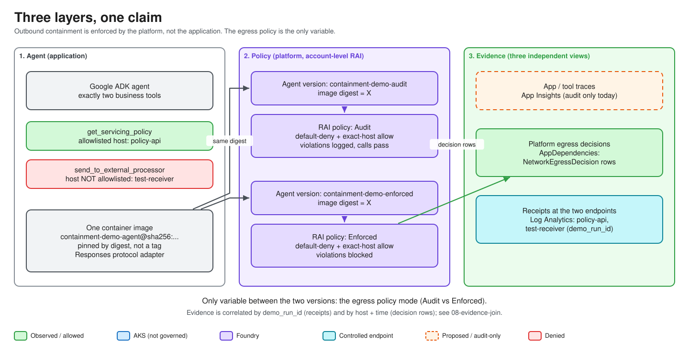

# Workshop

Learn how the lab separates user authorization, agent governance, and network
containment. Basic Python, container, and Kubernetes knowledge is useful;
Azure concepts are introduced as needed.

Use the [Azure deployment guide](../rebuild-runbook.md) for all setup and cleanup.
The modules below explain the components and help you inspect a running demo.

| Module | Topic |
| --- | --- |
| [01 Architecture](01-architecture.md) | What runs where and what the experiment proves |
| [02 Prerequisites](02-prerequisites.md) | Tools, permissions, and configuration |
| [03 Infrastructure](03-infrastructure.md) | Foundry, AKS, networking, registry, and monitoring |
| [04 Identity](04-identity.md) | Allowed and denied users |
| [05 Agent and tools](05-agent-and-tools.md) | The two tools and the enforcement boundary |
| [06 Build and deploy](06-build-and-deploy.md) | Images, digest pinning, and deployment |
| [07 External access](07-external-access.md) | DNS, HTTPS, and Entra sign-in |
| [08 Harness UI](08-harness-ui.md) | Chat, identity cards, and tool results |
| [09 Run and verify](09-run-and-verify.md) | Audit versus Enforced |
| [10 Monitoring](10-monitoring.md) | Find and correlate the evidence |
| [11 Teardown and rebuild](11-teardown-and-rebuild.md) | Cleanup order and rebuild state |
| [12 Troubleshooting](12-troubleshooting.md) | Symptoms and checks |

Use synthetic data only. Azure resources and model calls incur charges.
Local checks test functionality; platform decisions and receipts establish
containment. Missing evidence is **inconclusive**.

For Microsoft 365 Copilot, use the separate [Copilot walkthrough](../governance-demo.md).
